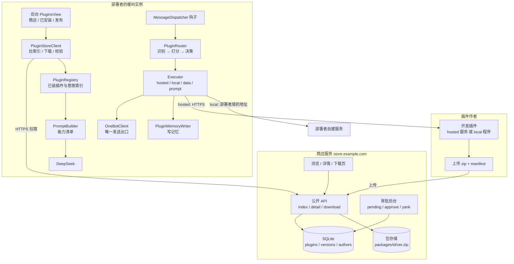
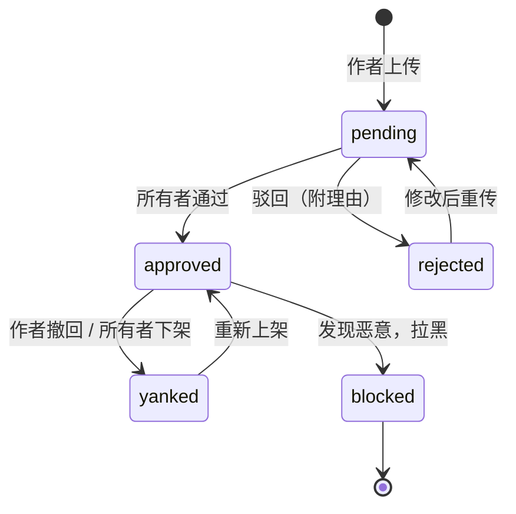
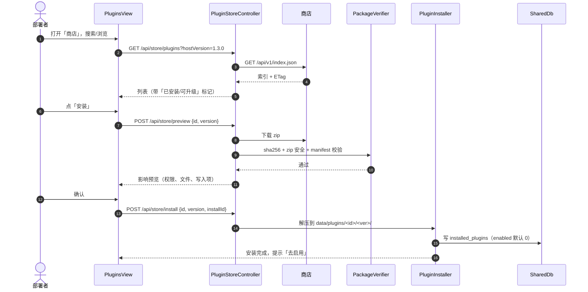
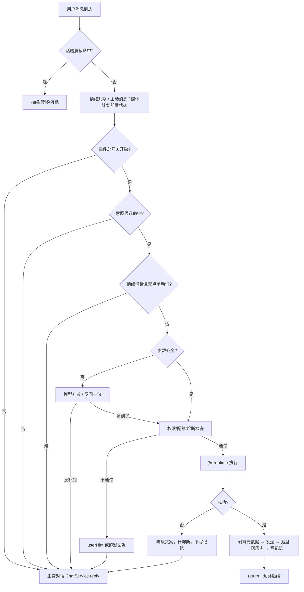
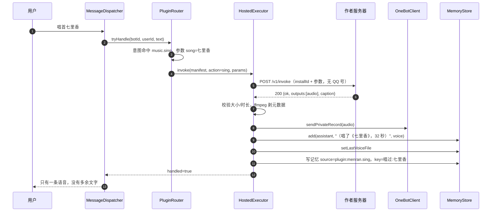
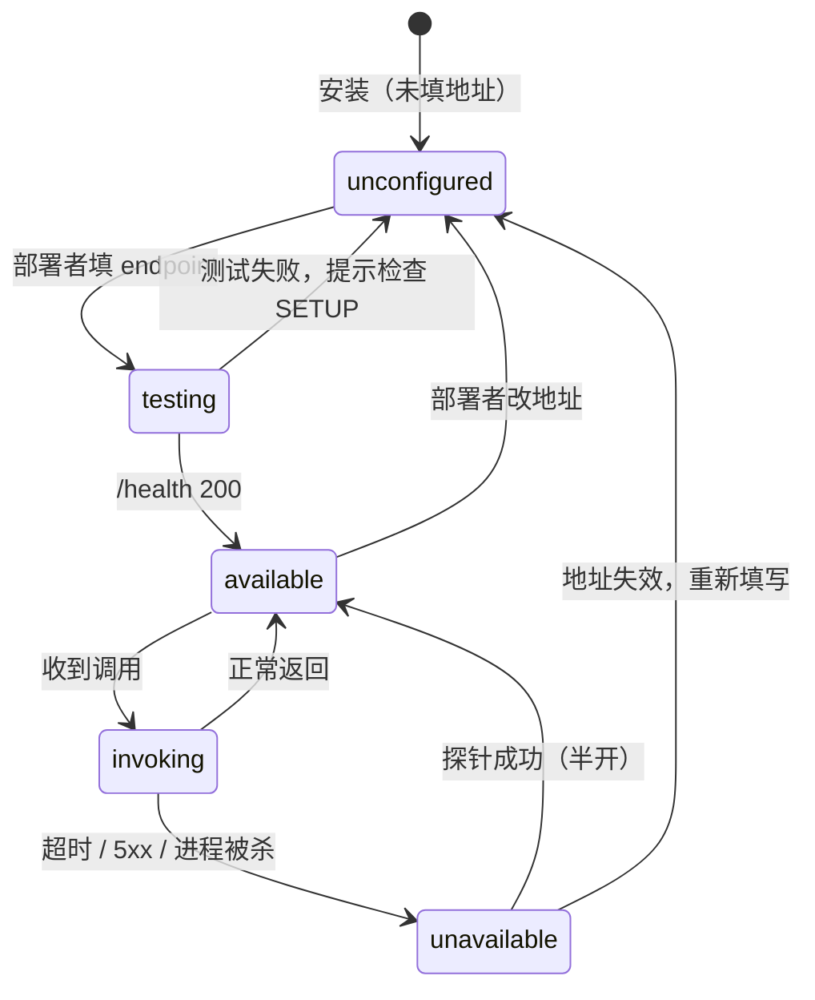
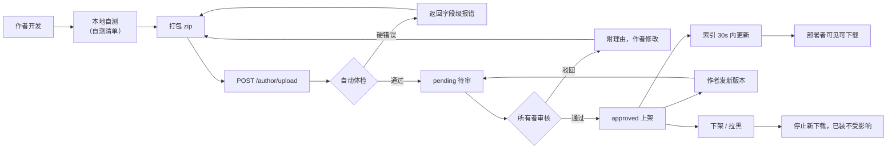
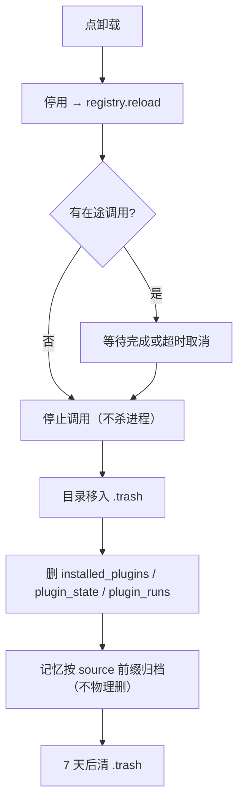

# 暖屿插件商店设计文档 v2.3

| 项 | 值 |
|---|---|
| 版本 | v2.3（上线版） |
| 日期 | 2026-11-10 |
| 状态 | 已上线；发布、审核、更新、密钥轮换均已实现 |
| 适用代码 | `warm_isle`（Java 21 / Spring Boot 3 / Vue 3 / SQLite / NapCat 或 SnowLuma OneBot v11） |
| 取代 | `docs/plugin-store-design.md`（v1，内容包时代，部分前提已失效） |
| 对齐 | `docs/plugin-refactor-plan.md`、`docs/plugin-io-contract.md`、`docs/plugin-dev-spec.md`（差异见 §13.4） |

**一句话：** 商店只管分发和审批，宿主只管执行和约束，插件运行期不回连商店。部署者能浏览、下载、按需启用；作者能上传、等审批；机器人装上就能在对话里真的用出来。

---

## 0. 先看结论：本方案定下的 17 件事

1. **插件分四类**：`data`（查表）、`prompt`（宿主代调模型）、`hosted`（作者服务器 API）、`local`（部署者自建服务/本机环境）。你说的两种方式对应 `hosted` 和 `local`，都支持，但风险等级和审核标准不同。
2. **商店是独立服务**，`store.example.com`，Node + SQLite + 文件存储，不塞进 Spring Boot，也不塞进 blog-app。
3. **上架必须人工审批**：`pending → approved / rejected`，审批后台是唯一入口；部署者在商店里只能看到 `approved`。
4. **安装是实例级，启用是账号级**：一份包装一次，哪个 bot 用由各账号自己开。
5. **运行期不回连商店**：商店挂了不影响已装插件；拉索引失败用本地缓存；启动路径绝不同步请求商店。
6. **能力要被模型“知道”**：已启用插件会生成一段极短的能力清单进 system prompt；用户明确点单时走意图路由直接执行，不靠模型自由发挥。
7. **触发靠意图不靠关键词**：`intent.id` + `examples` 建索引，宿主打分仲裁；作者自填的 priority 不作为排序依据。
8. **宿主独占协议层**：插件只能返回内容，发不发、怎么发、发给谁由宿主决定；插件永远拿不到 OneBot 连接。
9. **出站字段由宿主拼**：QQ 号、昵称、群号、聊天原文一律不进请求体（除非 manifest 显式声明 `accepts.text`）。
10. **本地型是高风险能力**：默认关闭，需部署者显式开启 + 逐次确认；优先 Docker，其次二进制，最后才允许脚本。
11. **记忆默认不写**：`memory.policy` 默认 `none`；写了就按遗忘曲线活着，`source='plugin:<id>'`，可整包归档。
12. **先宿主后商店**：没有宿主，商店是空货架；没有商店，宿主也能本地装包。顺序不能反。
13. **插件音频并入现有语音频控**：共用 90 分钟间隔 / 3 条/天（明确点播 6 条），不再单开一套，否则用户能连点 10 首。
14. **`local` 改为「自托管服务」**：作者给安装说明和端点建议，部署者自己起服务、自己填地址；宿主只调用，不托管进程、不碰 docker.sock、不分配端口。
15. **商店独立部署**；音频统一 ≤ 1MB / 60 秒，所有出站回取走 SSRF 白名单。
16. **插件调用不阻塞用户队列**：同步 ≤ 20 秒，超时自动转异步（先 `ackText`，后台执行）；阻塞范围仅该用户。
17. **记忆只由宿主渲染**：插件响应只能回填模板变量，不能直接给 key/value/importance。

---

## 1. 目标与非目标

### 1.1 目标

| # | 目标 | 验收口径 |
|---|---|---|
| G1 | 部署源码的人能看到商店、按需下载安装 | 后台出现「插件商店」，未配置商店地址时优雅降级 |
| G2 | 作者可上传，经所有者审批后才可见 | 未审批的包在公开索引和下载接口都取不到 |
| G3 | 装上的插件能被 AI 实时调用 | 说「唱首七里香」直接出语音条，且没有多余文字 |
| G4 | 两种运行方式都支持 | `hosted` 调作者 API；`local` 在本机起进程，二者同一套 manifest 与调用契约 |
| G5 | 机器人知道自己会什么 | 问「你会唱歌吗」能答会；不该触发时（“今天好累”）不触发 |
| G6 | 做过的事记得住 | 隔天说「上次那首再来一遍」能接上 |
| G7 | 第三方能照着写 | 开发规范 + 示例包 + 自测清单 + 体检报错到字段 |
| G8 | 出问题能兜住 | 插件超时/崩溃/返回脏数据都不影响主对话 |

### 1.2 非目标（明确不做）

| 不做 | 原因 |
|---|---|
| 插件市场社区（评分、评论、关注、订阅） | 冷启动没人用；先把机制跑通 |
| 付费插件 / 订单 / 授权校验 | 涉及支付、退款、发票，单开设计 |
| 多租户 SaaS 版商店 | 分发只服务本框架的部署实例，量级几十 |
| 插件沙箱 / 容器编排平台 | 2C/3.6G 跑不动；`local` 型靠系统用户 + 资源限制 + 审批兜底 |
| 插件内嵌 JS/脚本引擎 | 引入解释器 = 任意代码执行，收益不抵风险 |
| 运行期热更新代码 | 升级 = 换版本目录 + 重启该插件实例，不做热补丁 |
| 商店回传实例数据 / 遥测 | 商店不碰实例业务数据，只记匿名下载量 |

### 1.3 一条贯穿全文的原则

> **未装插件时，行为与今天逐字节相同。**
> 所有钩子必须有「空实现立即返回」分支；插件全部停用时，主链路开销 < 5%。

---

## 2. 总体架构



### 2.1 组件职责

| 组件 | 位置 | 职责 | 不负责 |
|---|---|---|---|
| 商店服务 | `store.example.com` | 索引、详情、下载、上传、审批、下架、统计 | 执行插件、接触实例数据 |
| 商店客户端 | 实例内 Java | 拉索引、缓存、下载、sha256、版本比较 | 决定装不装（用户点） |
| 插件注册表 | 实例内 | 解析已装包、建意图索引、启停 | 网络 |
| 路由器 | 实例内 | 判断这句话要不要插件、哪个插件、参数够不够 | 执行 |
| 执行器 | 实例内 | 按 runtime 调 hosted/local/data/prompt，统一结果 | 发送 |
| 宿主钩子 | `MessageDispatcher` | 短路接入、落库、发送 | 业务逻辑 |
| 记忆写入 | 实例内 | 按 policy 渲染并写 `memories` | 长期画像（只写 bot 行为） |

### 2.2 部署拓扑

| 服务 | 机器 | 端口 | 说明 |
|---|---|---|---|
| 暖屿主程序 | 2C/3.6G 腾讯云 | 8080 | 现有 jar / Docker |
| NapCat | 同机 | 3001 / 6099 | 现有 |
| 商店服务 | **独立最小实例** | 127.0.0.1:3500 | Caddy 反代 `store.example.com` |
| hosted 插件 | 作者自己的服务器 | 作者定 | 必须 HTTPS |
| local 插件 | 部署者自建（宿主机 / 兄弟容器 / 局域网） | 部署者定 | 通过 `host.docker.internal` 或容器名访问 |

> 商店必须独立部署：主程序容器组的 `mem_limit` 合计已接近宿主机内存，且 `/var/run/docker.sock` 已挂进 qqbot 容器，商店不应再共享这台机器。

---

## 3. 角色与信任边界

| 角色 | 能做什么 | 不能做什么 | 信任级别 |
|---|---|---|---|
| 所有者（你） | 审批、下架、吊销、看统计 | 看实例聊天记录 | 最高 |
| 插件作者 | 上传、发新版本、撤回、看自己下载量 | 看别人实例数据、改已发布版本；不能自助注册，由所有者发邀请码创建 | 中，需审批 |
| 部署者 | 浏览、安装、启用、卸载、配权限 | 上架、改包 | 中 |
| 最终用户 | 在聊天里触发 | 感知插件存在（除非告知） | 低 |
| 插件进程 | 收参数、返回内容 | 碰 OneBot、读主库、拿 QQ 号 | 最低 |

三条硬边界：

1. **商店 → 实例**：只有实例主动拉，商店永远不推送、不回调实例。
2. **实例 → 插件**：请求体由宿主构造，字段白名单写死在代码里。
3. **插件 → 用户**：插件只产出内容，发送由宿主执行；音频/图片先剥元数据再发。

---

## 4. 插件类型与运行方式

### 4.1 四类 runtime

| runtime | 插件在哪跑 | 包里有代码吗 | 网络 | 典型场景 | 风险 |
|---|---|---|---|---|---|
| `data` | 宿主内查表 | 否（只有 json/音频/图片） | 无 | 唱歌（预合成 mp3）、表情包、语录 | 低 |
| `prompt` | 宿主代调模型 | 否（模板 + 数据） | 无（宿主出网） | 塔罗、心理测试、写诗 | 低 |
| `hosted` | 作者的服务器 | 否（包里只有 manifest） | 宿主 → 作者 HTTPS | 唱歌（作者合成）、查快递、天气 | 中 |
| `local` | 部署者自建的服务 | 否（包里只有说明与 manifest） | 宿主 → 部署者提供的地址 | 本地 TTS、本地模型、需要 GPU 的能力 | 中 |

**你提的两种方式就是 `hosted` 和 `local`。** 同一套 manifest、同一套 `/v1/invoke` 契约，宿主只换 executor，路由、记忆、配额、熔断全部复用。

> `local` 不是“宿主替你装软件、起进程”，而是“部署者按作者的 `SETUP.md` 自己起一个服务，后台填地址”。原因见 §7.6：生产是全容器部署，容器里的 127.0.0.1 不是宿主机的 127.0.0.1，而 `docker.sock` 已在 qqbot 容器里，不能把起容器的能力交给插件。

### 4.2 怎么选（写进开发规范）

推荐顺序：**data → prompt → hosted → local**。绝大多数插件不需要自己的服务器。

| 如果你的能力… | 选 | 你要付出的运维 |
|---|---|---|
| 只是固定素材 / 词表 / 预设 | `data` | 无 |
| 只是让模型按模板生成 | `prompt` | 无 |
| 需要自己的算力、模型、数据库 | `hosted` | 域名、HTTPS 证书、7×24 可用、限流、计费 |
| 必须用部署者本机的软件 / GPU | `local` | 部署者自己安装并保持运行，你只提供说明 |

> 真实世界里 90% 的第三方作者不会为一个小功能长期维护服务器。规范的第一推荐必须是 `data` / `prompt`，`hosted` 的运维成本写在 §10.4 开头，避免作者一进门就被“先搭个 API”劝退。

### 4.3 运行期依赖与降级

| 情况 | 行为 |
|---|---|
| `hosted` 作者服务器挂了 | 该插件熔断，用户收到 `userHint` 或宿主兜底一句；不影响其他插件与主对话 |
| `local` 服务连不上 | 保存端点时先测 `/health`，失败不允许启用；运行中失败则熔断并提示，宿主不尝试重启 |
| 商店挂了 | 用本地缓存索引；下载失败明确报错；已装插件完全不受影响 |
| 宿主升级导致 `apiVersion` 不兼容 | 插件标记「待升级」，不触发；后台提示 |

---

## 5. 插件包格式与 manifest

### 5.1 包结构

```
menran.sing-1.2.0.zip
├── manifest.json          必需
├── README.md              必需，商店详情页渲染
├── CHANGELOG.md           建议
├── icon.png               可选，256×256，≤200KB
├── preview.png            可选，1200×630，≤300KB
├── SETUP.md               仅 local 型：部署者安装/启动说明
├── assets/                可选，data 型的素材
│   └── voice/qilixiang.mp3
└── prompts/               可选，prompt 型的模板
    └── tarot.md
```

约束：

- 包是 zip，扩展名 `.zip`（不再用 `.wplugin`，降低作者心智负担）。
- **所有包 ≤ 20MB；`data` 型含素材可到 50MB**，下载器按 runtime 区分上限。
- 包内**一律禁止** `.sh .bat .ps1 .exe .dll .so .jar .class .py .js`——`local` 型也不带代码，服务由部署者自己装，所以这条没有例外。
- 禁止绝对路径、`..`、符号链接、加密 zip。
- 文件名统一 UTF-8，禁止中文路径（避免跨平台解压乱码）。

### 5.2 manifest 完整字段

```json
{
  "schemaVersion": 2,
  "id": "menran.sing",
  "name": "唱歌",
  "version": "1.2.0",
  "apiVersion": 1,
  "runtime": "hosted",
  "description": "让机器人真的唱出来，支持点歌和随机",
  "author": { "name": "menran", "url": "https://example.com", "email": "hi@example.com" },
  "license": "MIT",
  "tags": ["娱乐", "音乐"],
  "icon": "icon.png",
  "readme": "README.md",
  "compat": { "minHostVersion": "1.0.0", "maxHostVersion": null },
  "intent": {
    "id": "music.sing",
    "examples": ["唱首歌", "来一首", "唱个歌", "想听你唱", "给我唱一段吧"],
    "exclusive": false
  },
  "actions": [
    {
      "name": "sing",
      "description": "为用户唱一首歌",
      "params": {
        "song":  { "type": "string", "required": false, "description": "歌名，没说就随机" },
        "style": { "type": "enum", "required": false, "values": ["温柔", "欢快", "伤感"] }
      },
      "returns": ["audio"],
      "timeoutMs": 60000
    }
  ],
  "hosted": {
    "endpoint": "https://api.menran.cn/nuanyu/sing",
    "health": "/health",
    "auth": "none"
  },
  "permissions": {
    "network": { "outbound": ["api.menran.cn"], "purpose": "合成歌曲音频" },
    "memory": { "write": true },
    "localService": null
  },
  "voice": { "strategy": "audio" },
  "memory": {
    "policy": "episodic",
    "type": "relation",
    "keyTemplate": "唱过:{song}",
    "valueTemplate": "《{song}》，{duration}秒",
    "importance": 0.85
  },
  "quota": { "perUserPerDay": 10, "globalPerHour": 60 },
  "createdAt": "2026-11-06",
  "changelog": "CHANGELOG.md"
}
```

### 5.3 字段规则

| 字段 | 必填 | 规则 |
|---|---|---|
| `schemaVersion` | ✅ | 固定 `2` |
| `id` | ✅ | `^[a-z0-9][a-z0-9._-]{2,48}$`，必须属于作者命名空间（`menran.sing` 只能由 `menran` 发布），发布后不可改 |
| `name` | ✅ | 2–20 字，商店内不重名 |
| `version` | ✅ | 严格 semver `x.y.z`，同版本不可重复上传 |
| `apiVersion` | ✅ | 整数，当前只支持 `1` |
| `runtime` | ✅ | `data` / `prompt` / `hosted` / `local` |
| `description` | ✅ | ≤ 80 字，进索引 |
| `author.name` | ✅ | 署名；`email` 仅商店后台可见 |
| `license` | ✅ | SPDX 标识；缺失拒绝发布 |
| `tags` | ✅ | 1–6 个 |
| `compat.minHostVersion` | ✅ | semver；低于此版本的实例索引里看不到 |
| `intent.id` | ✅ | 全局命名空间；公共意图见附录 A，私有意图用 `作者.xxx` 自留 |
| `intent.examples` | ✅ | 5–10 条完整句子，**≥ 3 字**，不带实体名；3 字示例只做全等匹配 |
| `actions` | ✅ | ≥1 个；每个 action 的 `returns` 决定宿主怎么发 |
| `hosted` | `hosted` 必填 | `endpoint` 必须 HTTPS 且域名已在 `permissions.network.outbound` 中 |
| `local` | `local` 必填 | 见 §10.5，只给 `SETUP.md` 与端点建议，包内不得含安装脚本 |
| `permissions` | ✅ | 缺省视为「无网络、不写记忆、不可本地执行」 |
| `memory` | ❌ | 缺省 `policy: none` |
| `quota` | ❌ | 缺省 `perUserPerDay: 5`，上限 50 |
| `voice.strategy` | `returns` 含 audio 时必填 | `audio`（插件给成品音频）或 `lyrics`（给歌词+曲调，宿主 TTS 合成） |
| `memory.policy` 一致性 | — | `policy != none` 时必须 `permissions.memory.write=true`，否则体检拒绝 |
| `local` | `local` 必填 | 只声明安装说明与端点建议，**包内不得含可执行文件** |

### 5.4 校验分三层

| 层 | 时机 | 内容 |
|---|---|---|
| 结构校验 | 上传时 + 安装时 | zip 安全、路径、大小、扩展名、manifest 正则、引用完整性 |
| 语义校验 | 上传时 | actions 与 returns 一致、示例句质量、记忆模板变量、权限自洽 |
| 人工审核 | 上传后 | 域名归属、隐私说明、内容合规、实际跑一遍 |

**安装时再校验一遍**，因为包可能在商店被替换（虽然概率低，但校验成本只有毫秒级）。

---

## 6. 商店服务端设计

### 6.1 部署形态

| 项 | 值 |
|---|---|
| 机器 | **独立最小实例**（2C2G），不与主程序同机（主程序 compose 的 `mem_limit` 合计约 4.9G，宿主仅 3.6G） |
| 域名 | `https://store.example.com` |
| 进程 | Node 20 + Express/Fastify，独立 systemd 服务 |
| 监听 | `127.0.0.1:3500` |
| 用户 | `storeapp`（无登录 shell） |
| 数据 | `/opt/nuanyu-store/data/{store.db,packages/,tmp/}` |
| 备份 | 每日 `sqlite3 .backup` + 包目录 rsync；保留 7 天 |
| 日志 | journald + 访问日志按天切割 |
| 依赖 | `better-sqlite3`、`unzipper`、`semver`、`sharp`（缩略图，可选） |

Caddy：

```caddyfile
store.example.com {
    encode zstd gzip
    handle /api/* { reverse_proxy 127.0.0.1:3500 }
    handle /admin/* { reverse_proxy 127.0.0.1:3500 }
    handle /* { reverse_proxy 127.0.0.1:3500 }
    header {
        X-Content-Type-Options nosniff
        Referrer-Policy strict-origin-when-cross-origin
        Content-Security-Policy "default-src 'self'; img-src 'self' data: https:"
    }
}
```

### 6.2 数据模型

```sql
CREATE TABLE authors (
  id           TEXT PRIMARY KEY,          -- uuid
  name         TEXT NOT NULL,
  email        TEXT,
  token_hash   TEXT NOT NULL,             -- sha256(authorToken)
  status       TEXT NOT NULL DEFAULT 'active',  -- active / suspended
  created_at   TEXT NOT NULL
);

CREATE TABLE plugins (
  id           TEXT PRIMARY KEY,          -- manifest.id
  owner_id     TEXT NOT NULL,
  name         TEXT NOT NULL,
  summary      TEXT NOT NULL,
  status       TEXT NOT NULL DEFAULT 'pending', -- pending/approved/rejected/yanked/blocked
  latest       TEXT,
  downloads    INTEGER NOT NULL DEFAULT 0,
  created_at   TEXT NOT NULL,
  updated_at   TEXT NOT NULL
);

CREATE TABLE versions (
  id           INTEGER PRIMARY KEY AUTOINCREMENT,
  plugin_id    TEXT NOT NULL,
  version      TEXT NOT NULL,
  runtime      TEXT NOT NULL,
  api_version  INTEGER NOT NULL,
  min_host     TEXT NOT NULL,
  sha256       TEXT NOT NULL,
  size         INTEGER NOT NULL,
  manifest     TEXT NOT NULL,
  readme       TEXT,
  status       TEXT NOT NULL DEFAULT 'pending',
  review_note  TEXT,
  submitted_at TEXT NOT NULL,
  reviewed_at  TEXT,
  UNIQUE(plugin_id, version)
);

CREATE TABLE downloads (
  id        INTEGER PRIMARY KEY AUTOINCREMENT,
  plugin_id TEXT NOT NULL,
  version   TEXT NOT NULL,
  ip_hash   TEXT NOT NULL,
  day       TEXT NOT NULL
);
CREATE UNIQUE INDEX ux_dl ON downloads(plugin_id, version, ip_hash, day);

CREATE TABLE revocations (
  plugin_id TEXT NOT NULL,
  version   TEXT,                         -- NULL 表示整插件
  reason    TEXT NOT NULL,
  created_at TEXT NOT NULL
);

CREATE TABLE intents (
  id          TEXT PRIMARY KEY,
  description TEXT NOT NULL,
  exclusive   INTEGER NOT NULL DEFAULT 0,
  reserved    INTEGER NOT NULL DEFAULT 1  -- 1=官方保留
);

CREATE TABLE audit_log (
  id        INTEGER PRIMARY KEY AUTOINCREMENT,
  actor     TEXT NOT NULL,
  action    TEXT NOT NULL,
  target    TEXT,
  detail    TEXT,
  created_at TEXT NOT NULL
);
```

**三条约定（避免实现时各写各的）：**

1. `submissionId = versions.id`，不单独建 submissions 表。
2. `plugins.latest` 不作为权威值：索引生成时按 `status='approved'` 的最高版本重算，指向 `yanked` 视为无效。
3. `plugins.downloads` 只是缓存，权威值 = `COUNT(downloads)`，每日校准一次。

### 6.3 公开 API

| 方法 | 路径 | 说明 |
|---|---|---|
| GET | `/api/v1/index.json` | 已上架插件索引，带 `ETag`、15 分钟缓存 |
| GET | `/api/v1/plugins/:id` | 详情：README、权限、版本列表、下载量 |
| GET | `/api/v1/plugins/:id/versions/:version` | 单版本 manifest（不含包体） |
| GET | `/api/v1/download/:id/:version` | 下载 zip，计一次下载量 |
| GET | `/api/v1/intents.json` | 意图注册表快照（宿主做离线校验用） |
| GET | `/api/v1/revocations.json` | 吊销名单（签名，见 §6.8） |
| GET | `/healthz` | 健康检查 |

`index.json` 结构（**只放列表所需字段，不放 README 和包体**）：

```json
{
  "schemaVersion": 1,
  "generatedAt": "2026-11-10T02:00:00Z",
  "intentsVersion": 3,
  "plugins": [
    {
      "id": "menran.sing",
      "name": "唱歌",
      "summary": "让机器人真的唱出来",
      "latest": "1.2.0",
      "runtime": "hosted",
      "apiVersion": 1,
      "minHostVersion": "1.0.0",
      "intent": "music.sing",
      "tags": ["娱乐", "音乐"],
      "icon": "https://store.example.com/icon/menran.sing.png",
      "downloads": 128,
      "updatedAt": "2026-11-06",
      "sha256": "…",
      "size": 1834221
    }
  ]
}
```

客户端按 `?hostVersion=1.3.0&apiVersion=1` 请求时，服务端过滤掉不兼容项，避免装了才发现用不了。

### 6.4 作者 API

| 方法 | 路径 | 鉴权 | 说明 |
|---|---|---|---|
| POST | `/api/v1/author/register` | 邀请码（仅所有者发放） | 创建作者身份，分配 `namespace`，返回 `authorToken`；支持轮换与后台找回 |
| GET | `/api/v1/author/me` | `X-Author-Token` | 我的插件与状态 |
| POST | `/api/v1/author/upload` | token | 上传 zip，返回体检结果 |
| POST | `/api/v1/author/plugins/:id/yank` | token | 撤回某版本 |
| POST | `/api/v1/author/token/rotate` | token | 轮换 token |

上传响应（体检失败要报到处）：

```json
{
  "ok": false,
  "submissionId": "sub_01",
  "errors": [
    { "field": "manifest.intent.examples[2]", "code": "EXAMPLE_TOO_SHORT", "message": "示例句至少 3 个字" },
    { "field": "permissions.network.outbound[0]", "code": "DOMAIN_NOT_DECLARED", "message": "endpoint 域名未在 permissions 中声明" }
  ]
}
```

### 6.5 审核后台

| 方法 | 路径 | 说明 |
|---|---|---|
| GET | `/admin` | 登录后进入待审队列 |
| GET | `/api/v1/admin/pending` | 待审列表，按提交时间排序 |
| POST | `/api/v1/admin/review/:submissionId` | `{action: "approve" \| "reject", note}` |
| POST | `/api/v1/admin/yank/:pluginId` | 下架（可指定版本） |
| POST | `/api/v1/admin/revoke` | 加入吊销名单 |
| GET | `/api/v1/admin/stats` | 下载量、作者数、待审数 |

审核页必须一屏看到（与 §12.1 的 10 项一一对应，直接标红/绿）：

- manifest 全字段 + 与上一版本的 diff
- 权限声明（网络域名、本地执行、写记忆）
- README 渲染
- 体检结果（含自动冒烟调用记录）
- 作者信息与历史通过率
- 「实际调用一次」按钮（沙箱环境，带超时）

### 6.6 状态机



规则：

- **一个 `id` 只能有一个 owner**，先到先得；作者 token 才能发新版本。
- 新版本独立走 `pending`，不影响已上架旧版本继续被下载。
- 下架 ≠ 远程卸载：只停止新下载和索引展示，已装实例继续可用（后台标「已下架」）。
- `blocked` 会进吊销名单，宿主下次拉索引时标记「已拉黑」，**不自动卸载**（见 §6.8）。
- 同版本重传：`status in ('rejected','pending')` 时允许覆盖同一 version（先删后插）；`approved` / `yanked` 必须升版本号。

### 6.7 索引生成与缓存

- 索引由 DB 重建，写 `index.json` 原子替换（`write tmp + rename`）。
- 触发时机：审核通过/下架/新版本，最多 30 秒内生效。
- `ETag = sha256(index.json)`；客户端带 `If-None-Match`，304 不重复传输。
- 商店侧 CDN 缓存 5 分钟；客户端本地缓存 15 分钟，过期后**先返回旧值再后台刷新**。

### 6.8 下载、校验与吊销

- 下载 302 到静态文件，`Content-Disposition: attachment`，`X-Checksum-Sha256`。
- 单 IP 每分钟 ≤ 30 次下载；超限 429。
- 下载量按 `(plugin, version, ip_hash, day)` 去重，不存原始 IP；`ip_hash = HMAC-SHA256(IP_HASH_SECRET, ip)`，盐只存环境变量、可轮换，避免 IPv4 空间被暴力还原。
- **sha256 从第一天就校验**：客户端下载后必须比对索引里的值，不一致直接拒绝安装。
- **签名（M2）**：`revocations.json` 和 `index.json` 用 Ed25519 签名，公钥内置在宿主；防止商店被入侵后投毒。
- **吊销**：宿主每次刷新索引时顺带拉 `revocations.json`；命中则把该插件标记为「已拉黑」。**签名上线前（M2 之前）只做提示、不阻断触发**——否则商店一被入侵就能远程关掉所有插件。签名上线后才停止触发，且**永远不远程静默卸载**。

### 6.9 安全与运维

| 风险 | 对策 |
|---|---|
| zip 炸弹 / 路径穿越 | 解压前读中央目录校验条目数、总大小、路径；解压到 tmp 后逐文件白名单 |
| 上传接口被刷 | 作者 token + 每作者每小时 10 次 + 全局 100 次 |
| 商店被打 | Caddy 限流、下载限速、索引 CDN 缓存 |
| 包被篡改 | sha256 + 签名（M2） |
| 审批后台被爆破 | 独立密码 + 2FA（TOTP）+ 登录失败锁定 |
| 商店拖垮主站 | 独立进程/用户/端口，不与 8080 共享资源 |
| 数据丢失 | 每日 DB 备份 + 包目录快照 |

---

## 7. 实例端设计

### 7.1 模块划分

```
src/main/java/com/qqbot/plugin/
├── model/           PluginManifest, PluginAction, PluginIntent, PermissionSet
├── manifest/        ManifestParser, ManifestValidator
├── package/         PackageReader, PackageVerifier（zip 安全）
├── registry/        PluginRegistry, IntentIndex, CapabilityCatalog
├── store/           PluginStoreClient, StoreIndex, StoreCache
├── install/         PluginInstaller, VersionResolver
├── routing/         PluginRouter, RouteRequest, RouteDecision, SlotExtractor, IntentScorer
├── exec/            PluginExecutor, HostedExecutor, LocalExecutor, DataExecutor, PromptExecutor
│                    PluginTaskRunner（bot 级异步）, InvocationEnvelope, PluginResult
│                    CircuitBreaker, QuotaService, VoiceBudget
├── net/             UrlFetcher（SSRF 白名单、DNS 固定、大小/超时限制）
├── local/           LocalServiceRegistry（端点登记、连通性测试；不托管进程）
├── memory/          PluginMemoryWriter, CaptionGuard
├── api/             PluginAdminController, PluginStoreController
├── PluginSchema     INSTANCE_DDL / BOT_DDL 两套建表语句
└── PluginProperties
```

> `local` 不再有 `LocalSupervisor`（启停进程、端口分配、ulimit 全部删除），只剩端点登记与健康检查，代码量从 220 行降到约 80 行。

### 7.2 安装状态与数据表

**决策：安装记录放 `SharedDb`（实例级），启用状态放各 bot 的 `Db`（账号级）。**

**建表方式（整改 F1）：`SharedDb` 没有自己的 `SCHEMA`，它在 `SharedDb.init()` 里直接遍历 `Db.SCHEMA`（`SharedDb.java:43`）。因此插件表绝不能塞进 `Db.SCHEMA`，否则会同时出现在 shared.db 和每个 bot 库。新增两套独立 DDL：**

```java
public final class PluginSchema {
    /** 只在 shared.db 建：SharedDb.init() 末尾执行 */
    public static final String[] INSTANCE_DDL = { /* installed_plugins */ };
    /** 只在每个 bot 库建：Db.init() 的 SCHEMA 循环之后执行 */
    public static final String[] BOT_DDL = { /* plugin_state / plugin_runs / plugin_proposals */ };
}
```

`SharedDb`：

```sql
CREATE TABLE IF NOT EXISTS installed_plugins (
  install_id    TEXT PRIMARY KEY,      -- uuid
  plugin_id     TEXT NOT NULL UNIQUE,
  version       TEXT NOT NULL,
  runtime       TEXT NOT NULL,
  source        TEXT NOT NULL,         -- store / upload / builtin
  sha256        TEXT,
  manifest      TEXT NOT NULL,
  status        TEXT NOT NULL,         -- installed / broken / revoked
  endpoint      TEXT,                  -- 仅 local：部署者填的地址（实例级，所有 bot 共用）
  installed_at  TEXT NOT NULL,
  updated_at    TEXT NOT NULL
);
```

> v2.0 的 `plugin_snapshots` 删除：那是 v1 内容包时代“装人设/词表要回滚”的遗留，v2 的 data/prompt 型不写这些配置，没有写入方。

每个 bot 的 `Db`：

```sql
CREATE TABLE IF NOT EXISTS plugin_state (
  plugin_id     TEXT PRIMARY KEY,
  enabled       INTEGER NOT NULL DEFAULT 0,
  permissions   TEXT,                  -- 用户确认过的权限快照（JSON）
  manifest_hash TEXT,                  -- 升级后比对，变化则要求重新确认
  updated_at    TEXT NOT NULL
);

CREATE TABLE IF NOT EXISTS plugin_runs (
  id             INTEGER PRIMARY KEY AUTOINCREMENT,
  plugin_id      TEXT NOT NULL,
  plugin_version TEXT NOT NULL,        -- 升级后能定位是哪版干的
  invoke_id      TEXT NOT NULL UNIQUE, -- 幂等键
  intent_id      TEXT,
  action         TEXT,
  status         TEXT NOT NULL,        -- ok / error / timeout / rejected / pending
  error_code     TEXT,
  latency_ms     INTEGER,
  params         TEXT,
  created_at     TEXT NOT NULL
);

CREATE TABLE IF NOT EXISTS plugin_proposals (
  id          INTEGER PRIMARY KEY AUTOINCREMENT,
  plugin_id   TEXT NOT NULL,
  created_at  TEXT NOT NULL,
  status      TEXT NOT NULL DEFAULT 'pending'  -- pending/accepted/rejected/expired
);
```

**多账号纪律（P0-5）：** 所有异步路径（下载、健康检查、异步任务轮询、配额清理、卸载归档）入口第一行必须 `BotContext.run(botId, ...)`，否则 `Db.open()` 会落到默认账号（`Db.java:523`），把 `plugin_runs` / `plugin_state` / 记忆写进账号 1 的库。`PluginExecutor.execute` 签名强制带 `botId`。

### 7.3 安装流程



关键约束：

1. **预览与应用必须分两次请求**，预览绝不写库；用户看到的差异和实际写入必须一致。
2. 安装默认 **不启用**，启用是显式动作。
3. 安装失败要能回滚到「没装」：先解压到临时目录，全部校验通过后再原子 rename。
4. 同一 `plugin_id` 重复安装 = 升级，保留旧版本目录用于回滚。

### 7.4 启用 / 停用 / 升级 / 卸载

| 动作 | 行为 |
|---|---|
| 启用 | 校验 permissions 与 `manifest_hash`（升级后变化则要求重新确认）→ 写 `enabled=1` → `registry.reload()` → 重建意图索引与能力清单 |
| 停用 | `enabled=0` → `registry.reload()` → 立即不再触发（在途请求允许完成） |
| 升级 | 下载新版本 → 预览 → 安装到新目录 → 切换 `installed_plugins.version` → 比对 `manifest_hash`，权限有变则重新确认 → 保留旧目录 7 天（local 服务由部署者按 SETUP 自行升级） |
| 回滚 | 切回上一版本目录 + 版本号；local 重启；记忆不回滚（避免“记忆里唱过但实际没唱”错位） |
| 卸载 | 见下 |

卸载顺序（不能乱）：

```
1. 遍历所有 bot：plugin_state.enabled = 0
2. registry.reload()              // 路由立即不再引用
3. 取消在途任务
4. 目录 rename 到 data/plugins/.trash/<id>-<ts>/
5. 删除 installed_plugins（shared.db）
6. 遍历 bots/*.db：删 plugin_state / plugin_runs / plugin_proposals
7. 遍历 bots/*.db：按 source LIKE 'plugin:<id>%' 归档记忆（不物理删）
8. 7 天后清理 .trash
```

### 7.5 商店客户端与离线策略

| 项 | 值 |
|---|---|
| 索引缓存 | 内存 + `data/cache/store-index.json`，TTL 15 分钟 |
| 刷新方式 | 过期后先返回缓存，后台异步刷新（stale-while-revalidate） |
| 超时 | 连接 3s / 读取 10s（索引）、下载 60s |
| 下载上限 | 单包 50MB，超出中断 |
| 降级 | 商店不可达时，商店页显示「商店暂不可用」，已装列表照常 |
| 启动 | **绝不在启动路径同步拉索引**；开机 60 秒后异步预热 |
| 版本比较 | semver，`minHostVersion ≤ 当前 hostVersion` 才显示可装 |

配置：

```yaml
qqbot:
  plugin:
    enabled: ${PLUGIN_ENABLED:true}
    dir: ${PLUGIN_DIR:./data/plugins}
    store:
      url: ${PLUGIN_STORE_URL:https://store.example.com}
      connect-timeout: 3s
      read-timeout: 10s
      index-ttl: 900s
    local:
      enabled: ${PLUGIN_LOCAL_ENABLED:false}   # 允许接入部署者自建服务；端点存在 plugin_state.endpoint
    limits:
      per-user-per-day: 10
      global-per-hour: 60
      circuit-failures: 5
      circuit-open: 5m
```

`PLUGIN_STORE_URL` 留空则隐藏商店入口，其余功能不受影响——fork 的人可以指向自己的商店或完全关掉。

### 7.6 local 型：自托管服务接入

**定案：不改部署形态，改 local 的定义。**

> `local` = 部署者按作者提供的 `SETUP.md` 自己把服务跑起来，然后在后台填地址；宿主只做 HTTP 调用，不启动、不重启、不杀进程。

原因（代码事实）：`qqbot` 跑在容器里（`deploy/linux/docker-compose.yml`，`mem_limit 1200m`），容器里的 `127.0.0.1` 是容器自己；宿主机的 `127.0.0.1` 容器访问不到。而 `/var/run/docker.sock` 已经挂进 qqbot 容器，如果再让插件声明镜像、由宿主起容器，攻击面就从“插件返回脏数据”升级为“插件拿宿主机 root”。

**为什么不用审阅给的 A / B / C：**

- **A 宿主 agent**：在宿主机再跑一个 systemd 服务。能成立，但多一套部署、多一个需要 root 的组件，而且部署者要改 compose 的 `extra_hosts`，对“装个插件”来说太重。
- **B 只做 docker kind**：插件容器加入 `ai-companion_default`，宿主用容器名访问。需要把 `docker.sock` 的使用权暴露给插件安装流程，等于把宿主机 root 的入口开放给第三方包；且与“只能绑 127.0.0.1”的规范冲突。
- **C 砍掉 local**：最省事，但你明确要求“本地装环境”这条路也要支持，砍掉等于少一半需求。
- **采用 D（本文）**：部署者自己起服务、自己填地址，宿主只做 HTTP 调用。既保留 local 的用法，又不新增进程、不碰 `docker.sock`、不要求宿主执行安装命令；成本约 3 人日（原 5–8）。

| 项 | 规则 |
|---|---|
| 端点来源 | 部署者在后台填写，存 `installed_plugins.endpoint`（**实例级，填一次所有 bot 共用**）；manifest 只给 `endpointHint`，保存前必须通过 `/health` 测试 |
| 三种典型地址 | 宿主机服务：`http://host.docker.internal:34001`（compose 加 `extra_hosts: ["host.docker.internal:host-gateway"]`）；兄弟容器：`http://nuanyu-sing:8080`；局域网：`http://192.168.x.x:34001` |
| 进程管理 | 宿主不启动、不重启、不杀进程；连不上就熔断并提示，不尝试拉起 |
| 更新 | 部署者按 `SETUP.md` 自行更新；宿主只校验 manifest 版本，不执行任何安装命令 |
| 安装校验 | `requires` 只用于**展示**“还需要 ffmpeg / NVIDIA 驱动”，宿主不检测宿主环境（容器里检测不到） |
| 安全 | 只允许部署者填写的 host；仍拒绝 `169.254.169.254`、云元数据、`127.0.0.1:8080/8081` 管理端口；禁止 30x |
| 兼容 | 与 `hosted` 共用同一套 `/v1/invoke` 契约，只是地址是私网 |

被删除的内容（在容器部署下没有落点）：`nuanyu-plg` 系统用户、`ulimit` 二进制、`script` kind、端口 34000–34999 自动分配、宿主代拉镜像。

### 7.7 权限与二次确认

| 权限 | 触发确认 | 展示文案 |
|---|---|---|
| `network.outbound` | 安装 + 启用 | 「会把歌名发送到 api.menran.cn，不发送聊天内容」 |
| `memory.write` | 安装 | 「会向记忆库写入记录（类型：我做过的事），每天最多 5 条」 |
| `localService` | 安装 + 启用 | 「会连接你在本机启动的服务，地址只保存在本地」 |
| `llm.use`（prompt） | 启用 | 「会消耗你的模型额度，单次约 850 tokens」 |

隐私模式（可选开关）：只允许 `data` / `prompt`，`hosted` / `local` 一律不触发。

---

## 8. 实时对接 AI：机器人怎么“知道”自己会唱歌

插件装上了不等于会用。这里有三层，缺一层都表现为“装了没反应”：

| 层 | 作用 | 落点 |
|---|---|---|
| 认知层 | 模型知道自己有这个能力 | `PromptBuilder` 注入能力清单（很短） |
| 决策层 | 这句话该不该触发、触发哪个 | `PluginRouter` 意图识别 + 打分 |
| 执行层 | 参数够不够、怎么调、结果怎么发 | Executor + 参数抽取 + 宿主发送 |

### 8.1 认知层：能力清单（按需注入，不常驻）

**不能每次对话都把全量清单塞进 system**：8 条 × 40 字 = 320 字，是每一次请求都在付费（§8.1 旧版只给了上限，没给“什么时候不该注入”）。

| 场景 | 注入什么 |
|---|---|
| 用户问“你会什么 / 会不会唱歌 / 能做什么” | 全量清单（≤ 8 条 / 300 字） |
| 本轮路由命中了某插件 | 只注入**那一条** |
| 某插件刚启用的 3 轮内 | 全量清单（帮模型建立印象） |
| 其余普通闲聊 | **不注入，0 token** |

全量清单示例：

```
【你会的能力】（只在对方明确需要时使用，不要主动炫耀，也不要说"我是插件"）
- 唱歌（music.sing）：对方想听歌、点歌、"来一首"时，直接唱，不要说"我不能发语音"
- 塔罗（divination.tarot）：对方想算牌、问运势时
```

要点：

- 只在有启用插件时出现；没插件时 prompt 与今天**完全一致**（满足 §1.3）。
- 用“你会”而不是“可用插件”，避免模型说“我可以调用插件”。
- 明确写“不要说不能发语音”——模型很容易在能力清单存在时仍然按旧习惯拒绝。
- “会什么”的判定用正则（`会.{0,6}吗`、`能.{0,4}什么`、`有什么本领`），命中才注入全量，避免白付 token。

### 8.2 决策层：两段式路由

不能把所有插件的工具描述都塞进 system prompt（20 个插件能把 prompt 从 1000 字涨到 3000 字，还会拖慢每一次回复）。所以：

```
第一段（零 token，所有消息都跑）
  意图示例倒排 + catalog 别名匹配
  ├─ 没命中 → 直接放行，进正常对话
  └─ 命中候选 → 参数是否齐全？
        ├─ 齐全 → 直接执行，不调模型
        └─ 不全 → 进第二段

第二段（只在候选消息上发生，单次 +1~2s）
  只把命中的那一个插件的 tool 描述交给模型补参
  模型返回参数 → 校验 → 执行
  模型没给出 / 超时 1.5s → 反问一句（FILL_PARAMS），不瞎猜
```

命中判定（按优先级）：

| 级别 | 规则 | 例子 | 成本 |
|---|---|---|---|
| L1 精确 | 意图示例全等 / `catalog` 别名全等 | 「唱首七里香」 | 0 |
| L2 包含 | 用户句包含示例或别名（示例 ≥4 字才做包含；3 字只做全等） | 「你能给我唱首歌吗」 | 0 |
| L3 语义 | 向量相似度 ≥ 0.80 | 「来一段周杰伦的」 | 一次 embedding |
| L4 模型 | 以上都没有，但模型自己想调 | 复杂表达 | 一次模型调用（默认不开） |

L3 直接复用现有 `EmbeddingClient.embedOne`（imageguard `/embed`，bge-small-zh-v1.5，512 维）+ `MemoryVectorService.cosine`；**imageguard 不可用时自动降级为纯 L1/L2，不报错、不阻塞**。不需要新模型，也不需要新依赖。

P0 只做 L1/L2；L3 在 P1 打开；L4 默认关闭（避免模型“过度热情”）。

### 8.3 打分与仲裁

```
score = 0.5 × 语义相似度
      + 0.3 × 关键词命中强度
      + 0.2 × 该插件近 30 天采纳率
```

| 分数 | 动作 |
|---|---|
| ≥ 0.75 | 执行 |
| 0.50–0.75 | 补参 / 或反问一句“想听哪首？” |
| 0.35–0.50 | 提议（P2，默认关） |
| < 0.35 | 忽略 |

硬规则：

- **作者自填的 priority 不参与排序**，只用于同分时的稳定排序。
- `exclusive=true` 只用于有独占副作用的意图（`reminder.create`、`game.play`、`media.video`）；娱乐类意图（唱歌、塔罗、语录）**允许多插件共存**。
- 共存时按「采纳率 → 冷却 → 最近使用」仲裁；用户可在后台把某个插件设为该意图的首选。
- 注意：**语义阈值 0.80 与综合执行线 0.75 是两个数**，实现时不要拿语义分直接比执行线。
- 纯情绪倾诉（“好累”“烦死了”）**永不触发**，词表写死在宿主（见 §8.8）。
- 追问回填：原句含“上次/那首/刚才/再来/又”且缺参数时，查 `recentDeeds` 回填，命中直接把分数提到 0.85（否则“上次那首再来一遍”语义分只有 0.6 左右，永远够不到执行线）。

### 8.4 参数抽取（三级）

| 级 | 方法 | 覆盖 |
|---|---|---|
| ① catalog | 别名全等 / 最长子串 | “唱七里香” → `song=七里香` |
| ② 正则槽位 | 作者声明的 `pattern` | “明天下午三点提醒我交房租” |
| ③ 模型补参 | 单轮、只喂这句话 + 候选值、1.5s 超时 | “来一首适合下雨天的” |

三级都失败 → 返回 `FILL_PARAMS`，宿主用 `ambiguousHint` 反问一句，**不执行、不写记忆**。

### 8.5 执行与短路

钩子位置（`MessageDispatcher`）：`emotional.observe(...)` 之后、`mediaPlanner.plan(...)` 之前。

```java
// 伪代码，实际返回 PluginOutcome
PluginOutcome outcome = pluginGateway.tryHandle(botId, userId, userText);
if (outcome.handled()) {
    return;   // 插件已经把该发的发完了，整条链路到此为止
}
```

为什么在这里：

- 话题屏蔽已经先跑（屏蔽优先，插件不能绕过）。
- `mediaPlanner` 还没跑（不会出现“插件唱歌 + 媒体计划又发语音”双份）。
- `chatService.reply` 还没跑（不会多一条文字）。
- 这里拿得到 `OneBotClient`，发送不依赖 `reply()` 的返回值。

短路的返回约定与 `ChatVoiceReplier.maybeSend()` 一致：返回 `true` 表示“我处理了，别再发文字”。

**线程模型（N3）：插件不能拖死用户队列。**

`MessageDispatcher` 每个用户一个单线程 worker（`bot-reply-<uid>`，`MessageDispatcher.java:57`），插件调用就跑在这条队列上。所以：

| 情况 | 规则 |
|---|---|
| 同步 action | `timeoutMs` 默认 15s，**硬上限 20s**；超过按超时处理 |
| 长任务（> 20s：合成、视频） | 宿主按 `timeoutMs > 20000` 自动转异步：先发 `ackText`，任务交给 bot 级后台线程池（`BotContext.run(botId)`），用户队列立即释放 |
| 阻塞范围 | **仅该用户**；其他用户与 WS 接收线程不受影响（`onEvent` 只做分发） |
| 并发 | 同一用户同一插件同时只允许 1 个在途任务；新消息到达时注入“你正在为他做 X”上下文 |

> 取舍写在这里：不做全异步，是因为多数插件 1–3 秒就返回，全异步会丢掉“同一用户消息保序”的现有语义。

### 8.6 结果落点顺序（不能反）

```
⓪ 执行前：per-user 配额 + VoiceBudget 预占（不足直接 userHint，不调插件、不烧作者算力）
① 校验结果（大小、类型、时长、是否为空）；图片过 ImageGuardClient.check，音频过 ffprobe
② 剥离元数据（音频 ID3 / 图片 EXIF）
③ 发送：client.sendPrivateRecord / sendPrivateImage / sendPrivate(text)
④ 落盘：voiceFiles.save(audio) → 得到可回放 URL
⑤ 落历史：messages.add(userId, "assistant", "（唱了《七里香》，32 秒）", "voice")
⑥ 记文件：messages.setLastVoiceFile(userId, "assistant", file)
⑦ 写记忆：pluginMemoryWriter.write(...)
```

`⓪` 的预占在 ③ 失败或 ① 校验失败时释放，避免“没发出去却扣了额度”。

**先发后写**。反过来的话会出现“记忆里唱过，但用户根本没收到”。

audio 绝不进 `content`，只存 `voice_file` 列；`content` 里只放语义描述。

### 8.7 记忆策略

| policy | 用途 | 写入 |
|---|---|---|
| `none`（默认） | 一次性消费（塔罗、查天气） | 不写 |
| `episodic` | 做过的事（唱歌、发视频） | 写一条 `type=relation, subject=bot, source=plugin:<id>` |
| `commitment` | 答应用户的事（提醒） | 写 + `followUp` 到期检查 |

硬约束（宿主强制，不信作者）：

- `subject` 只能是 `bot`，不能写用户画像。
- `type` 只能是 `relation` / `event`。
- `importance` 封顶 0.85（commitment 0.95）。
- `value` ≤ 80 字，且必须包含具体实体（≥6 字、不能是纯动词）。
- 每天每插件 ≤ 5 条（与安装确认文案一致，20 条会把 500 条容量的库一直打到 trim）；`perUserPerDay` 配额单独算。
- key 必须带实体名（`唱过:七里香`），否则永远只记得最后一首；写入前宿主再加插件前缀（`menran.sing:唱过:七里香`），避免两个插件写同一个 key 互相 archive。
- 相同 key 重复写 = 复习效应（现有 `upsert` 的 sameValue 分支会续命，不用额外维护）。
- **运行期不得自带 key/value**：插件响应里的 `memory` 只允许 `vars`，键必须是模板里出现过的占位符；`key` / `value` / `importance` / `source` 前缀全部由宿主渲染。未知变量直接判 `BAD_PARAMS`，不写记忆。

指代回填靠 `recentDeeds(qqId, 7 天, 5 条)` 辅路，按时间取，不靠相似度——因为“再唱一遍上次那首”这种句子关键词命中是 0。

### 8.8 失败、超时与降级

| 情况 | 用户看到 | 系统 |
|---|---|---|
| 参数缺失 | “想听哪首呀？” | `FILL_PARAMS`，不写记忆 |
| 插件返回业务错误 | `userHint`（作者写的） | 不计熔断 |
| 超时 | “这次没唱成，等下再试试” | 计熔断 |
| 连接失败 / 5xx | 同上 | 计熔断 |
| 返回体积超限 | 静默降级为文字 caption | 丢弃媒体 |
| 熔断打开 | 直接走正常对话 | 5 分钟内不再调用 |
| 配额用尽 | “今天唱得有点多啦” | 不发请求 |
| 语音额度用尽（与日常语音共用） | 同语音频控的提示 | 回 userHint，不发送 |
| 图片被 NSFW 预筛判敏感 | 不发图，降级为文字 | 丢弃媒体，不写记忆 |

熔断计数：60 秒内 5 次失败 → 打开 5 分钟；半开时放 1 个探针。

**情绪倾诉保护**（写死在宿主，作者不可关）：

```
累、烦、难受、难过、想哭、被骂、吵架、崩溃、压力、不开心、emo
```

命中且没有明确点单动词（唱/来一首/放/查）时，不触发任何插件，交回正常对话。这是插件生态最容易翻车的地方——“好累啊”回一句“要不要我给你唱首歌”非常败好感。

---

## 9. 全流程图

### 9.1 消息进入后的完整决策流程



### 9.2 hosted 插件调用时序



### 9.3 local 自托管服务的连接状态



要点：宿主不重启进程，只做健康检查与熔断；`unavailable` 时插件不触发、后台标红，恢复由部署者按 `SETUP.md` 处理。

### 9.4 作者发布与审批



### 9.5 卸载与回滚



---

## 10. 插件开发规范（面向作者）

> 这一节是可以直接发给第三方作者的版本。标注「必须」的条目在发布体检时强制校验。

### 10.1 你要先选一种 runtime

| 你的情况 | 选 | 你要提供 |
|---|---|---|
| 固定素材，不需要计算 | `data` | manifest + 素材文件 |
| 只要模型按模板生成 | `prompt` | manifest + 提示词模板 + 数据 |
| 有自己的服务器/模型 | `hosted` | 一个 HTTPS 接口，实现 3 个端点 |
| 必须用用户本机环境 | `local` | 一个可运行的服务 + `SETUP.md` |

唱歌插件三种都能做：`data`（预合成 mp3）、`hosted`（你合成）、`local`（本地 TTS）。

### 10.2 包结构（必须）

```
<id>-<version>.zip
├── manifest.json     必须，UTF-8，≤ 64KB
├── README.md         必须，≤ 200KB
├── CHANGELOG.md      建议
├── icon.png          可选，256×256
├── preview.png       可选，1200×630
├── assets/           可选，素材
├── prompts/          可选，prompt 模板
└── SETUP.md          仅 local 型：部署者安装/启动说明
```

禁止：可执行文件（**没有例外**，`local` 型也不带代码）、绝对路径、`..`、符号链接、加密、中文路径名。

### 10.3 manifest（必须）

字段与规则见 §5.2 / §5.3。几条最容易错的：

1. `id` 用 `作者.能力` 命名空间，发布后**永远不能改**（记忆 key 依赖它）。
2. `intent.examples` 必须是**用户真的会说的完整句子**，不能是“唱歌”“音乐”这种词。
3. `intent.examples` 里**不能带具体实体名**（写“唱首歌”，不要写“唱七里香”），实体靠参数抽取。
4. `permissions.network.outbound` 必须列出 `hosted.endpoint` 的域名，否则体检直接拒。
5. `memory.policy` 不填就是 `none`，别为了“显得智能”乱写记忆。

### 10.4 hosted 型：HTTP 契约

**先算运维账**：选 `hosted` 意味着你要长期承担域名、HTTPS 证书、7×24 可用、限流、防刷、计费。为一个小功能这么做通常不划算——能用 `data` / `prompt` 就别上 `hosted`。

#### 端点

| 方法 | 路径 | 必须 | 说明 |
|---|---|---|---|
| GET | `/health` | 是 | 3 秒内 200，返回 `{"ok":true}` |
| POST | `/v1/invoke` | 是 | 同步调用，返回结果 |
| GET | `/v1/tasks/:taskId` | 否 | 异步任务轮询（长任务必须实现） |

#### 请求

```http
POST /v1/invoke
Content-Type: application/json
X-Plugin-Protocol: 1
X-Install-Id: 6f1c...（随机 UUID，与 QQ 号无映射，可轮换）
```

```json
{
  "apiVersion": 1,
  "invokeId": "9f2c1e6a-...",
  "pluginId": "menran.sing",
  "pluginVersion": "1.2.0",
  "action": "sing",
  "intentId": "music.sing",
  "params": { "song": "七里香", "style": "温柔" },
  "context": {
    "locale": "zh-CN",
    "timezone": "Asia/Shanghai",
    "time": "2026-11-10T10:00:00+08:00",
    "timeoutMs": 60000,
    "output": { "kinds": ["audio"], "maxBytes": 1048576 }
  }
}
```

**宿主保证不会发送**：QQ 号、昵称、群号、聊天原文、历史消息、精确到秒的调用时间（除非 manifest 声明 `accepts.text: true`，才把这句话作为 `params.text` 发送，且安装时必须明确告知用户）。

#### 同步响应

```json
{
  "ok": true,
  "outputs": [
    {
      "kind": "audio",
      "mime": "audio/mpeg",
      "durationMs": 32000,
      "sha256": "…",
      "url": "https://cdn.menran.cn/sing/abc.mp3"
    }
  ],
  "caption": "唱了《七里香》",
  "memory": {
    "vars": { "song": "七里香", "duration": 32 }
  }
}
```

也可以内联小文件：`{"kind":"audio","dataBase64":"..."}`（≤ 1MB）。超过 1MB 必须用 `url`，且只允许 HTTPS。

**`memory` 只能是变量回填**：`vars` 的键必须出现在 manifest 的 `keyTemplate` / `valueTemplate` 占位符里；宿主用它渲染并加前缀。旧的 `{key,value,importance}` 写法 v1 一律忽略，不写记忆。

**音频来源（`voice.strategy`）**：`audio` 表示插件返回成品音频；`lyrics` 表示插件返回歌词 + 曲调参数（`{"lyrics":"…","melody":"…"}`），由宿主用机器人自己的 TTS 合成——声音还是她的。唱歌类插件 P1 用 `audio` 起步，M2 提供 `lyrics` 版本。

#### 回取 `url` 的 SSRF 规则（宿主实现，作者无需关心）

`outputs[].url` 由宿主下载，如果只校验 `https://` 挡不住任何东西（`https://127.0.0.1:8080`、`https://guard:8081`、`https://169.254.169.254` 都能打到）。M1 必须实现：

1. host 必须**同时在** `permissions.network.outbound` 白名单里；
2. 解析后校验 IP，拒绝 `10/8`、`172.16/12`、`192.168/16`、`127/8`、`169.254/16`、`::1`、`fc00::/7`；
3. 禁止 30x（或每跳重新执行 1、2，最多 3 跳）；
4. DNS 解析结果与连接目标一致，防 rebinding（解析后按 IP 直连并带 Host 头）；
5. 硬超时 15s、`Content-Length` ≤ 5MB，边下边计数，超限即断；
6. 下载后**再过一遍格式校验**（音频 `ffprobe` 能解析、图片能解码），不认的丢弃并降级为文字。

#### 异步响应（长任务）

```json
{ "ok": true, "pending": true, "taskId": "t_123", "ackText": "好，等我一下" }
```

宿主会先发 `ackText`（`kind='progress'`，不进 prompt 历史），然后每 2 秒轮询 `GET /v1/tasks/t_123`，最长 90 秒。

#### 错误响应

```json
{
  "ok": false,
  "error": {
    "code": "BAD_PARAMS",
    "message": "不支持的曲风",
    "userHint": "这首我唱不好，换一首？",
    "retryable": false
  }
}
```

| code | 含义 | 计熔断 |
|---|---|---|
| `BAD_PARAMS` | 参数不合法 | 否 |
| `NOT_FOUND` | 没这个歌/资源 | 否 |
| `UNAVAILABLE` | 依赖服务不可用 | 是 |
| `TIMEOUT` | 超时 | 是 |
| `RATE_LIMITED` | 作者侧限流 | 否 |
| `INTERNAL` | 作者代码异常 | 是 |
| `UNSUPPORTED` | 不支持该 action | 否 |

#### 硬性要求

- 必须支持**幂等**：同 `invokeId` 重复调用返回同一结果，不重复扣费/生成。
- 必须在 `timeoutMs` 内返回（宿主会断开）；同步上限 20 秒，超过请声明更大的 `timeoutMs` 走异步，先回 `pending` + `ackText`。
- 单响应 ≤ 5MB；音频 ≤ **1MB / 60 秒**（`wsproxy` 只有 128MB、`MAX_BUFFER=500`，2MB 音频转 base64 会成为 2.7MB 文本帧，现实上发不出去）；图片 ≤ 5MB。
- 不允许 302 到非声明域名。
- 不允许返回 HTML / 脚本 / 可执行内容，宿主只认 `audio/* image/* text/plain`。
- `caption` 必须是「机器人做了什么」，不能写成「用户的事实」（写“你喜欢七里香”会被当成用户画像）。

### 10.5 local 型：自托管服务契约

`local` 型不是“宿主替你装环境”，而是**部署者按你的说明自己跑一个服务**。包里没有可执行文件，和 `hosted` 一样安全，只是地址在私网。

`manifest.local`：

```json
{
  "local": {
    "endpointHint": "http://host.docker.internal:34001",
    "health": "/health",
    "invoke": "/v1/invoke",
    "setup": "SETUP.md",
    "requires": [
      { "name": "ffmpeg", "hint": "需要安装 ffmpeg 4.4+" },
      { "name": "NVIDIA Driver", "hint": "需要 535+ 驱动", "optional": true }
    ]
  }
}
```

作者必须提供 `SETUP.md`，至少写清：

1. 依赖（系统、版本、GPU/驱动）；
2. 安装命令（逐条可复制）；
3. 启动命令与监听端口；
4. 如何验证 `/health`；
5. 如何升级、如何卸载；
6. 数据存在哪、会不会上传。

契约与 `hosted` 完全一致（`/health`、`/v1/invoke`、错误码、幂等、`X-Install-Id`），区别只有三点：

| 项 | hosted | local |
|---|---|---|
| 地址 | manifest 里写死 HTTPS | 部署者在后台填（manifest 只给建议） |
| 网络 | 公网 | 私网 / 容器网络 / 局域网 |
| 可用性责任 | 作者 | 部署者 |

`local` 的红线：

1. 不能要求宿主执行安装命令、拉起进程、挂载 `docker.sock`。
2. 不能监听 `0.0.0.0` 暴露到公网（规范要求绑 `127.0.0.1` 或容器内网）。
3. 不能要求读取插件目录以外的文件。
4. 安装确认必须展示「会连接你本机启动的服务」，并让部署者手动填地址。

### 10.6 data 型与 prompt 型

**data**：

```json
{
  "runtime": "data",
  "catalog": {
    "key": "song",
    "match": ["七里香", "晴天"],
    "entries": [
      { "value": "七里香", "aliases": ["七里香", "qilixiang"], "file": "assets/voice/qilixiang.mp3", "durationMs": 32000 }
    ]
  }
}
```

宿主查表 → 读文件 → 发送。包里没有任何可执行物，是最安全的形态。

**prompt**：

```json
{
  "runtime": "prompt",
  "prompt": { "system": "prompts/tarot.md", "maxTokens": 600, "temperature": 0.7 },
  "data": { "deck": "data/cards.json" },
  "variables": ["date", "cards", "profile"]
}
```

宿主代调模型，费用走部署者预算；模板变量白名单固定，模板只进 user 不进 system；安装时静态扫描 prompt injection 关键词。

### 10.7 意图与触发写法

| 要求 | 反例 | 正例 |
|---|---|---|
| ≥ 3 个字 | `歌`、`唱歌` | `唱首歌`、`来一首` |
| 完整句子 | `音乐` | `放点音乐吧` |
| 不带实体 | `唱七里香` | `唱个歌` |
| 覆盖不同说法 | 四条都是“唱歌” | “唱首歌”“来一段”“想听你唱” |

禁止单词、泛动词、语气词（`看`、`来`、`帮`、`那个`、`嗯`）——会把正常聊天吞掉，体检直接拒。

### 10.8 记忆模板写法

```json
"memory": {
  "policy": "episodic",
  "type": "relation",
  "keyTemplate": "唱过:{song}",
  "valueTemplate": "《{song}》，{duration}秒",
  "importance": 0.85
}
```

变量只有 `{song}`、`{duration}` 两个：运行期插件回 `"memory": {"vars": {"song":"七里香","duration":32}}`，宿主渲染成 `menran.sing:唱过:七里香` / `《七里香》，32秒`，再套用 importance 封顶与每日配额。

- `keyTemplate` 必须包含具体实体，否则只记得最后一次。
- `valueTemplate` 渲染后必须 ≥ 6 字且有信息量，不能是“唱了一首歌”。
- 变量集合 = 两个模板里的占位符；运行期 `vars` 缺失即 `BAD_PARAMS`，不做空字符串替换。

### 10.9 自测清单（发布前必须跑）

1. `/health` 3 秒内 200。
2. 每个 action 用默认参数调一次，返回 `ok`。
3. 同 `invokeId` 连调两次，结果一致（幂等）。
4. 故意传错参数，返回 `BAD_PARAMS` 而不是 500。
5. 断网/关服务，返回 `UNAVAILABLE`，宿主能熔断。
6. 音频 ≤ 1MB / 60 秒、图片 ≤ 5MB。
7. 60 秒内返回，或正确走 `pending`。
8. `caption` 是“机器人做了什么”，不是用户画像。
9. 不依赖任何从请求里拿到的 QQ 号/昵称（根本拿不到）。
10. 卸载/停用后，插件目录外没有任何残留。

### 10.10 版本与发布

- 严格 semver；`manifest` 字段只增不改，删字段必须升主版本。
- 新版本独立审核；旧版本保留，支持回滚。
- 作者撤回后，已装实例仍可用，但后台标「已下架」。
- 不允许在运行期远程改变行为（比如从自己服务器下发脚本），发现即拉黑。

---

## 11. 现有程序整改方案

### 11.1 代码现状（事实）

| 项 | 现状 |
|---|---|
| 插件相关 Java 代码 | **0**，`src/main/java` 下没有 `plugin` 包（153 个主代码 + 22 个测试 = 175） |
| 前端插件页 | 无，`web/src/views` 20 个视图里没有 `PluginsView.vue` |
| 数据库 | 只有 `MemoryStore.trim()` 预留了 `source='plugin'` 的淘汰顺序 |
| 文档 | 6 份、实测 3896 行；商店部分与后续方案冲突（见 §13.4） |
| 可复用能力 | `OneBotClient.sendPrivateRecord`(:514)、`sendPrivate`(:263)、`callAction`(:335)、`VoiceFileService`、`MemoryStore`、`ChatService.recordExchange`(:316)、`PromptBuilder.build`(:85)、`ImageGuardClient.check`、`Db`/`SharedDb` |
| 部署事实 | qqbot 在容器内（`mem_limit 1200m`），`/var/run/docker.sock` 已挂进容器；数据在 `deploy/linux/data/qqbot`（容器内 `/app/data`），每 bot 库是 `bots/<id>.db` |

### 11.2 新增与修改清单

#### 新增（Java）

| 文件 | 职责 | 约行数 |
|---|---|---|
| `plugin/PluginSchema.java` | `INSTANCE_DDL`（shared.db）与 `BOT_DDL`（每 bot 库）两套建表 | 60 |
| `plugin/model/PluginManifest.java` 等 | manifest 数据结构 + 校验 | 200 |
| `plugin/manifest/ManifestParser.java` | Jackson 解析 + 语义校验 | 100 |
| `plugin/package/PackageVerifier.java` | zip 安全、路径、大小、扩展名 | 120 |
| `plugin/registry/PluginRegistry.java` | 扫目录、解析、启停、热重载 | 160 |
| `plugin/registry/IntentIndex.java` / `CapabilityCatalog.java` | 意图倒排、能力清单（按需） | 130 |
| `plugin/store/PluginStoreClient.java` | 拉索引、下载、ETag、缓存 | 150 |
| `plugin/install/PluginInstaller.java` | 解压、校验、升级、卸载（遍历 bots） | 220 |
| `plugin/routing/PluginRouter.java` / `SlotExtractor.java` | 两段式路由、打分、补参 | 300 |
| `plugin/net/UrlFetcher.java` | SSRF 白名单、IP 校验、DNS 固定、大小/超时 | 130 |
| `plugin/exec/HostedExecutor.java` / `LocalExecutor.java` | HTTP 调用（公网/私网同一实现） | 160 |
| `plugin/exec/DataExecutor.java` / `PromptExecutor.java` | 查表 / 模板 + 代调模型 | 150 |
| `plugin/exec/CircuitBreaker.java` / `QuotaService.java` / `VoiceBudget.java` | 熔断、配额、语音频控（与 ChatVoiceReplier 共用） | 120 |
| `plugin/local/LocalServiceRegistry.java` | 端点登记、连通性测试（不托管进程） | 80 |
| `plugin/memory/PluginMemoryWriter.java` / `CaptionGuard.java` | 模板渲染、前缀、四步写入 | 130 |
| `plugin/api/PluginAdminController.java` / `PluginStoreController.java` | 后台与商店接口 | 270 |

#### 修改（Java）—— 每一条都对应一个整改项

| 文件 | 改动 | 对应 |
|---|---|---|
| `MemoryStore` | `trim()` 的 `source='plugin'` 改为 `source LIKE 'plugin%'`，注释同步 | P0-1 |
| `OneBotClient` | 新增 `sendPrivateRecordSync(userId, audio, timeoutMs)`，走现有 `callAction`，不改旧方法 | P0-4 |
| `MessageDispatcher` | `emotional.observe` 后、`mediaPlanner.plan` 前插入钩子；`handled` 直接 `return` | G3 |
| `PromptBuilder` | 能力清单改为按需注入（§8.1）；`isMediaMarker` 加「（唱了」「（播放了」 | §8.1 / M0 |
| `MessageStore.recent` | 排除 `kind='progress'` | M0 |
| `ReplyMarkers` | 增加 `FAKE_SING` 一类伪造标记清洗 | M0 |
| `Db.init()` / `SharedDb.init()` | 分别执行 `PluginSchema.BOT_DDL` / `INSTANCE_DDL`；**不动 `Db.SCHEMA`** | F1 |
| 所有异步入口 | 外层 `BotContext.run(botId, ...)`；`PluginExecutor.execute` 强制带 `botId` | P0-5 |
| `application.yml` + `web/src/router` | `qqbot.plugin.*`；`/plugins` | — |

> **删除 v2.0 的 `DeepSeekClient` 改动**：参数补参用现有的 `chat(messages, 0.1, 200)` 做一次性 JSON 抽取即可，不需要 tools 重载，少改一个高风险文件。

#### 新增（前端 / 商店）

| 文件 | 内容 |
|---|---|
| `web/src/views/PluginsView.vue` | 商店 / 已安装 / 发布 三 Tab；local 端点填写与「测试连接」 |
| `web/src/components/InstallPreviewDialog.vue` | 安装确认（权限、写入、音频来源、local 地址） |
| `store-app/` | 独立 Node 服务：索引、上传体检、审批、下架、下载、签名 |

### 11.3 分阶段实施

> 人日按 1 名熟悉代码的开发者估算；含自测，不含等待审批。原 v2.0 的 26 人日偏乐观，按代码现实重排为 **M0 + M1–M5，合计约 42 人日**（M3 因线程模型 +1）。

| 阶段 | 内容 | 人日 | 出口标准 |
|---|---|---|---|
| **M0 地基** | ① `trim` 改 LIKE + 单测 ② `sendPrivateRecordSync` ③ 异步 `BotContext` 规范 ④ `PluginSchema` 两套 DDL ⑤ `recent()` 排除 progress ⑥ `isMediaMarker` 加「唱了/播放了」 | 3 | 现有 100 个单测全绿（JDK 23）；未装插件时 100 条消息耗时差异 < 5% |
| **M1 宿主** | manifest+registry / installer+三道检查 / router(L1L2) / DataExecutor / 钩子 / 记忆四步 / VoiceBudget 前置 / 能力清单 / PluginsView（本地 zip）/ 官方唱歌包 | 12 | §11.4 的 1–10、12、13、16（11/14/15 不属本阶段） |
| **M2 商店** | Node 服务 / 索引 / 上传体检 / 审批后台 / 客户端 / 安装预览 / 升级回滚 / **Ed25519 签名** / IP-HMAC | 12 | 作者上传→审批→安装→触发 端到端；商店停掉不影响已装（§11.4 第 7 条） |
| **M3 hosted** | HostedExecutor + **SSRF 防护** / 熔断 / 配额 / 异步任务 / 线程模型 | 6 | 拔网线、脏 URL、超大响应都不影响主对话；§11.4 的 11、14 |
| **M4 prompt + 治理** | PromptExecutor / 模板扫描 / NSFW 预筛 / kill switch / 压测 | 6 | 单次调用 ≤ 1000 tokens；签名验签失败拒绝索引；§11.4 第 15 条 |
| **M5 local（可选）** | 自托管服务接入：端点登记、测试连接、熔断 | 3 | 部署者按 SETUP 起服务 → 填地址 → 能触发；不碰 docker.sock |

> **M0 不能省**：不先修 `trim`，M1 写完记忆模块才发现插件流水把用户记忆吃了；不先加发送回执，“先发后写”就没有判定依据。

### 11.4 验收脚本（手动，10 分钟）

```
1. 说“唱首七里香”              → 只收到语音条，无文字
2. 说“唱首不存在的歌”          → 收到 userHint，不写记忆
3. 说“今天好累啊”              → 正常文字回复，不触发插件
4. 说“你会唱歌吗”              → 自然回答“会”，不触发执行
5. 清空 messages 表并重启       → 说“上次那首再来一遍” → 仍能接上
6. 后台卸载插件                → 记忆 source LIKE 'plugin:menran.sing%' 全部归档
7. 停掉商店                    → 商店页提示不可用；已装插件正常触发
8. 不装任何插件重启             → 100 条消息耗时与改造前同量级
9. 关掉插件总开关              → 所有插件不触发，行为与改造前一致
10. 两个 bot 装不同插件         → 互不串台，启用状态各自独立
11. 插件返回 url=https://127.0.0.1:8080/api/...  → 拒绝（SSRF），不发内容，记安全日志
12. 拔掉 NapCat 后说“唱首七里香”  → 语音未发出；memories 不得出现 source LIKE 'plugin:menran.sing%'
13. 两个 bot 各触发 3 次同一插件   → bots/1.db 与 bots/2.db 的 plugin_runs 各 3 条，配额互不影响
14. 用 1MB mp3 走完整链路          → 30 秒内送达，wsproxy 不重启，qqbot 无 OOM
15. 插件返回一张 NSFW 图            → imageguard 判敏感 → 不发，降级文字，不写记忆
16. 装插件后狂聊 100 条触发 20 次 trim → archived 且 source NOT LIKE 'plugin%' 的条数 = 0
```

**归属**：1–10、12、13、16 → M1；7 → M2；11、14 → M3；15 → M4。M1 只做 data 型，不要求跑 11/14/15，避免“阶段出口写了根本测不了的项”。

### 11.5 灰度与回滚

- `qqbot.plugin.enabled=false` 时插件代码全部走空实现，等价于没改。
- 先在一个白名单账号开启，观察 24 小时：误触发率、平均延迟、异常日志。
- 出现“插件抢正常对话”时，一键关总开关即可，不需要回滚版本。
- 数据库改动全部是新增表/新增列，回滚旧 jar 不会报错（旧代码不读新表）。

### 11.6 风险登记

| 风险 | 概率 | 影响 | 对策 |
|---|---|---|---|
| 钩子位置不当，抢掉正常对话 | 中 | 高 | 白名单灰度；总开关；情绪保护 |
| 插件写爆记忆 | 中 | 高 | 默认 `none`；每日配额；`trim` 优先淘汰插件流水（已修） |
| 音色不一致（外挂 mp3 不是她的声音） | 高 | 高 | 规范里写“歌词+曲调、宿主 TTS 合成”的方向；P0 允许预合成但标注 |
| hosted 插件泄漏隐私 | 中 | 高 | 出站字段白名单；安装告知；隐私模式 |
| local 服务搞坏机器 | 低 | 中 | 默认关闭；只接部署者自建服务；审批 + 端点白名单；不执行安装命令 |
| 商店被入侵投毒 | 低 | 高 | sha256 + 签名；人工审核；吊销 |
| 2C 机器跑不动 | 中 | 中 | local 默认关；限 1–2 个；显示内存占用 |
| 作者服务器挂导致体验差 | 中 | 中 | 熔断、降级文案、后台状态 |
| 版权问题（歌曲） | 中 | 高 | 只收授权/自制素材；商店展示 license；投诉下架 |
| `trim` 前缀失效，插件吃掉用户记忆 | 中 | 高 | `source LIKE 'plugin%'` + 单测 + 验收第 16 条 |
| 异步线程没设 BotContext 写错库 | 中 | 高 | 统一包装 + 双 bot 验收第 13 条 |
| 回取 URL 打内网 / 云元数据 | 中 | 高 | URL 白名单 + 私网拒绝 + 无跳转 + DNS 固定 |
| 插件音频绕过语音频控 | 高 | 中 | 共用 `VoiceBudget`，计入 3 条/天 |

---

## 12. 运营与治理

### 12.1 审核标准（每次照这张表过）

| 检查 | 通过条件 | 不通过 |
|---|---|---|
| 邀请 | 作者由所有者邀请码创建 | 拒绝 |
| 身份 | 作者邮箱/联系方式可联系；`id` 前缀必须属于作者 namespace | 拒绝 |
| 域名归属 | `hosted.endpoint` 域名与作者声明一致，HTTPS 有效 | 拒绝 |
| 可用性 | `/health` 200；每个 action 实际调一次成功 | 拒绝或退回 |
| 权限自洽 | 声明的网络域名、写记忆、本地执行与实际行为一致 | 拒绝 |
| 隐私 | README 写清“发送什么、不发送什么” | 退回补充 |
| 内容 | 无违法、色情、暴力、政治敏感、侵权素材 | 拒绝 |
| 记忆 | 模板有实体、不写用户画像、不超过配额 | 退回 |
| 体积 | 包 ≤ 20MB，响应 ≤ 5MB | 拒绝 |
| 无远程改行为 | 不从我方服务器下发脚本/配置改变已审行为 | 拉黑 |

一审时间目标：**1 分钟内能看完一屏**。所以审核页必须把上面 10 项直接标绿/标红，而不是让人翻 JSON。

### 12.2 下架、拉黑与投诉

| 场景 | 动作 | 对已装实例 |
|---|---|---|
| 作者主动撤回 | `yanked` | 继续可用，后台标「已下架」 |
| 发现违规 | 下架 + 通知作者 | 继续可用，标「已下架」 |
| 确认恶意（偷数据/投毒） | `blocked` + 进吊销名单 | 停止触发，提示用户卸载；**不静默删** |
| 版权投诉 | 先下架，48 小时内处理 | 同上 |
| 作者服务器长期不可用 | 标「不可用」 | 熔断，提示 |

投诉入口：商店页脚 + 邮箱；处理记录进 `audit_log`。

### 12.3 版权与内容

- 上传即视为作者承诺拥有素材权利；商店展示 `license`。
- 歌曲类：优先自制/授权/纯音乐；翻唱需说明；收到投诉先下架。
- 不提供任何绕过版权保护的插件。
- 商店页脚放免责声明与投诉方式。

### 12.4 数据与统计

只统计**匿名、聚合**数据：

- 每个插件/版本的下载量（IP 哈希按天去重）。
- 作者数、待审数、通过率。
- 实例端可选上报「启用数」（默认关闭，且不含实例标识）。

不做：实例列表、聊天内容、用户画像、精确地理。

### 12.5 冷启动

商店上线前先有 3–5 个官方包，否则空货架没有验证价值：

1. 唱歌（`data` 或 `hosted`）——验证音频链路。
2. 塔罗（`prompt`）——验证模板与预算。
3. 提醒（`commitment`）——验证承诺记忆。
4. 语录/表情（`data`）——验证纯内容包。
5. 本地 TTS（`local`）——验证 local 监管（可后置）。

---

## 13. 与旧文档的差异及迁移

### 13.1 取代关系

| 文档 | 处理 |
|---|---|
| `plugin-store-design.md`（v1） | **本文取代**，v1 归档为历史动机记录 |
| `plugin-refactor-plan.md` | 继续有效；本文修正其中「安装记录放每 bot 库」「P1 才做商店」两处 |
| `plugin-io-contract.md` | 继续有效；本文 §10.4 是其对外版本 |
| `plugin-dev-spec.md` | 继续有效；本文 §10 是精简合并版，冲突时以本文为准 |
| `plugin-sing-walkthrough.md` | 继续有效，作为验收剧本 |
| `plugin-prompt-runtime.md` | 继续有效，对应本文 `prompt` 型 |

### 13.2 旧文档里仍然有效的部分

- 四档 runtime 的划分与安全模型。
- 两段式路由、意图注册表、打分归宿主。
- 记忆三 policy、`source='plugin:<id>'`、指代回填。
- 出入参信封字段、幂等、错误码。
- 唱歌插件全流程走查（安装→开启→调用→指代→卸载）。

### 13.3 已修正的结论

| 旧结论 | 现在 | 原因 |
|---|---|---|
| 插件只有「能力/内容」两类 | 四类 runtime | `prompt` 与 `local` 是不同的信任与执行模型 |
| 安装记录放每 bot 库 | 安装放 `SharedDb`，启用放每 bot 库 | 商店是实例级分发，多 bot 共用文件 |
| 商店 P1 才做 | M1 宿主、M2 商店 | 商店是核心诉求，但仍排在宿主之后 |
| `.wplugin` + `type: persona/...` | `.zip` + `runtime` | 内容包只是 `data` 型的一个特例 |
| `endpoint` 限 127.0.0.1 就安全 | 限 127.0.0.1 只限制谁能访问插件，不限制插件访问谁 | 安全边界是产品契约，不是字段校验 |
| 一次性 authorToken 够用 | 加轮换、找回、封禁 | 真实运营必然遇到丢 token |
| 商店只做静态索引 | 索引 + 审批 + 吊销 | 没有审批就不是商店，是网盘 |
| `local` 由宿主起进程 | `local` = 部署者自建服务，宿主只调用 | 容器里 127.0.0.1 不是宿主机；docker.sock 不能交给插件 |
| 12 个意图全 `exclusive` | 只有 reminder/game/media.video 独占，娱乐类共存 | 否则第二个唱歌插件永远启用不了 |
| 签名排 M4 | 签名排 **M2** | 无签名的吊销名单 = 远程关停所有插件 |
| 记忆每天 20 条 | **5 条/天/插件** | 20 条会把 500 条库一直打到 trim |
| 音频 ≤ 2MB | **≤ 1MB / 60 秒** | wsproxy 128MB + 2.7MB 文本帧发不出去 |

### 13.4 逐条迁移动作

1. `plugin-store-design.md` 顶部加一行「已被 v2 取代，见本文」。
2. `plugin-refactor-plan.md` §4.5 的 `installed_plugins` 位置改为 `SharedDb`，并补 `plugin_state` 在每 bot 库。
3. `plugin-refactor-plan.md` §12 的 P0/P1 范围按本文 §11.3 重排。
4. `plugin-dev-spec.md` 的 `endpoint` 安全表述改为「必须 HTTPS + 域名白名单」，删除“连不上外网”的错误表述。
5. 统一 `id` 正则为 `^[a-z0-9][a-z0-9._-]{2,48}$`（现三份文档不一致）。
6. 新增 `docs/plugin-store-v2.md`（即本文 v2.1），旧文档保留但标注状态。
7. `MemoryStore.trim()` 改 `LIKE 'plugin%'` 并补单测——这是 M0 的第一件事。
8. `OneBotClient` 增 `sendPrivateRecordSync`，旧方法不动。
9. `SharedDb` / `Db` 分别执行 `PluginSchema.INSTANCE_DDL` / `BOT_DDL`，不碰 `Db.SCHEMA`。

---

## 14. 决策记录（v2.1 已定）

### 14.1 v2.0 的 10 条

| # | 问题 | 结论 |
|---|---|---|
| 1 | `local` 默认开关 | **默认关**；开启后仍需逐插件填端点并测通 |
| 2 | 作者注册 | **邀请码**，仅所有者发放 |
| 3 | hosted 隐私政策 | **必须**提供链接 |
| 4 | 评分评论 | **不做** |
| 5 | 付费 | **不做** |
| 6 | 私有意图免审 | **免审**（`作者.xxx` 不冲突） |
| 7 | 商店部署 | **独立最小实例**（原“先同机”作废，见 §6.1） |
| 8 | 签名时间 | **M2**（原 M4 作废） |
| 9 | 唱歌音色 | M1 预合成；M2 出 `voice.strategy=lyrics` + 宿主 TTS |
| 10 | `accepts.text` | **允许但强告知** |

### 14.2 审阅新增的 5 条

| # | 问题 | 结论 |
|---|---|---|
| 1 | `local` 做不做、怎么做 | **不砍，改为自托管服务**（§7.6）：成本 3 人日，不碰 docker.sock，也满足“本地环境”需求 |
| 2 | 商店放哪 | **独立实例** |
| 3 | 插件音频是否共用语控 | **共用**：计入 90 分钟 / 3 条（明确点播 6 条） |
| 4 | 唱歌声音 | M1 预合成；M2 `lyrics` + 宿主 TTS |
| 5 | 签名提前不提前 | **提前到 M2** |

### 14.3 第二轮复审的 7 条

| # | 问题 | 结论 |
|---|---|---|
| N1 | 示例句 ≥4 字 vs 官方示例 3 字 | 规则降为 **≥3 字**；**3 字示例只做全等匹配**，不做包含，兼顾自然度与误触发 |
| N2 | 运行期 `memory` 绕过模板约束 | 响应只允许 `memory.vars`，键必须是模板占位符；key/value/importance/前缀全由宿主渲染，未知变量判 `BAD_PARAMS` |
| N3 | 插件跑在用户串行队列上会堵 2.5 分钟 | 同步硬上限 **20s**；`timeoutMs > 20000` 自动转异步（`ackText` + `PluginTaskRunner`）；阻塞范围仅该用户 |
| N4 | VoiceBudget 在执行后查，白烧算力 | 挪到执行前**预占**，发送/校验失败释放 |
| N5 | local 端点在每 bot 库，要填 N 遍 | 移到 `installed_plugins.endpoint`（实例级），启用仍按账号 |
| N6 | 验收 11/14/15 与 M1 错位 | 11/14 → M3，15 → M4，7 → M2；M1 出口改为 1–10、12、13、16 |
| N7 | 三个小项 | ① `ip_hash` 用 HMAC + 盐；② `id` 必须属于作者 namespace，上传校验前缀；③ L3 复用 `EmbeddingClient`，imageguard 挂了自动降级 L1/L2 |

## 15. 附录

### 15.1 首批公共意图注册表（12 个）

| intent id | 含义 | exclusive | 典型 action |
|---|---|---|---|
| `music.sing` | 唱歌 | 否（可共存） | sing |
| `music.play` | 放一首歌/音频 | 否（可共存） | play |
| `media.video` | 发一条视频 | 是 | fetch |
| `media.image` | 生成/发一张图 | 否（可共存） | draw |
| `divination.tarot` | 塔罗/算牌 | 否（可共存） | draw_cards |
| `divination.fortune` | 运势/星座 | 否（可共存） | fortune |
| `info.weather` | 天气 | 否（可共存） | query |
| `info.express` | 快递 | 否（可共存） | track |
| `reminder.create` | 提醒我 | 是 | create |
| `reminder.list` | 我有哪些提醒 | 否 | list |
| `story.tell` | 讲故事/哄睡 | 否（可共存） | tell |
| `game.play` | 小游戏 | 是 | start |

私有意图直接用自己的命名空间（`menran.xxx`），不需要申请；但不能占用上表 id。

独占只给有状态/资源冲突的意图（提醒、游戏、视频）；唱歌、塔罗、天气之类允许多个实现共存，由采纳率与冷却仲裁。

### 15.2 目录结构（部署后）

```
/srv/qqbot/deploy/linux/          # 宿主机仓库
├── docker-compose.yml
└── data/qqbot/                       # 挂到容器 /app/data
    ├── plugins/                      # 已安装插件（实例级）
    │   └── menran.sing/
    │       ├── 1.2.0/
    │       └── 1.1.0/                # 回滚用，7 天后清
    ├── logs/plugin-menran.sing.log
    ├── cache/store-index.json
    └── bots/<id>.db                  # 每 bot 库：plugin_state / plugin_runs

/opt/nuanyu-store/                    # 独立实例（不与 qqbot 同机）
├── app/                              # 商店 Node 服务
└── data/
    ├── store.db
    └── packages/menran.sing/1.2.0.zip
```

> `local` 型没有“宿主侧运行目录”：服务由部署者自己起，端点存在 `plugin_state.endpoint`，日志由部署者自己管。

### 15.3 示例一：hosted 唱歌插件（完整 manifest）

```json
{
  "schemaVersion": 2,
  "id": "menran.sing",
  "name": "唱歌",
  "version": "1.2.0",
  "apiVersion": 1,
  "runtime": "hosted",
  "description": "点歌、随机唱，支持温柔/欢快/伤感三种风格",
  "author": { "name": "menran", "url": "https://example.com" },
  "license": "MIT",
  "tags": ["娱乐", "音乐"],
  "compat": { "minHostVersion": "1.0.0" },
  "intent": {
    "id": "music.sing",
    "examples": ["唱首歌", "来一首", "想听你唱", "给我唱一段吧", "唱个歌呗"],
    "exclusive": false
  },
  "actions": [{
    "name": "sing",
    "description": "为用户唱一首歌。用户没说歌名就随机唱一首。",
    "params": {
      "song":  { "type": "string", "required": false, "description": "歌名" },
      "style": { "type": "enum", "required": false, "values": ["温柔", "欢快", "伤感"] }
    },
    "returns": ["audio"],
    "timeoutMs": 60000
  }],
  "voice": { "strategy": "audio" },
  "hosted": {
    "endpoint": "https://api.menran.cn/nuanyu/sing",
    "health": "/health",
    "auth": "none"
  },
  "permissions": {
    "network": { "outbound": ["api.menran.cn"], "purpose": "合成歌曲音频" },
    "memory": { "write": true },
    "localService": null
  },
  "memory": {
    "policy": "episodic",
    "type": "relation",
    "keyTemplate": "唱过:{song}",
    "valueTemplate": "《{song}》，{duration}秒",
    "importance": 0.85
  },
  "quota": { "perUserPerDay": 10, "globalPerHour": 60 }
}
```

### 15.4 示例二：local 唱歌插件（自托管服务）

```json
{
  "schemaVersion": 2,
  "id": "menran.sing-local",
  "name": "唱歌（本地）",
  "version": "1.0.0",
  "apiVersion": 1,
  "runtime": "local",
  "description": "用你本机的 GPU 合成，音频不出内网",
  "author": { "name": "menran" },
  "license": "MIT",
  "tags": ["娱乐", "音乐", "本地"],
  "compat": { "minHostVersion": "1.0.0" },
  "intent": {
    "id": "music.sing",
    "examples": ["唱首歌", "来一首", "想听你唱"],
    "exclusive": false
  },
  "actions": [{
    "name": "sing",
    "description": "用本机模型合成一首歌",
    "params": { "song": { "type": "string", "required": false } },
    "returns": ["audio"],
    "timeoutMs": 120000
  }],
  "voice": { "strategy": "audio" },
  "local": {
    "endpointHint": "http://host.docker.internal:34001",
    "health": "/health",
    "invoke": "/v1/invoke",
    "setup": "SETUP.md",
    "requires": [
      { "name": "NVIDIA Driver", "hint": "535+", "optional": true },
      { "name": "ffmpeg", "hint": "4.4+" }
    ]
  },
  "permissions": {
    "localService": { "allow": true, "reason": "连接本机合成服务" },
    "memory": { "write": true }
  },
  "memory": {
    "policy": "episodic",
    "type": "relation",
    "keyTemplate": "唱过:{song}",
    "valueTemplate": "《{song}》，{duration}秒",
    "importance": 0.85
  }
}
```

配套 `SETUP.md` 摘要：安装 ffmpeg → 拉取镜像 / 解压程序 → `docker run -p 34001:8080 ...` → `curl http://127.0.0.1:34001/health` → 回后台填 `http://host.docker.internal:34001`。宿主只读这份说明，不执行。

### 15.5 术语表

| 术语 | 含义 |
|---|---|
| 实例 / instance | 一份部署好的暖屿程序，可能跑多个 bot |
| bot | 一个 QQ 账号对应的机器人 |
| manifest | 插件包里的元数据文件 |
| runtime | 插件的执行方式：data / prompt / hosted / local |
| intent | 意图，用户“想干什么”的抽象，不是关键词 |
| exclusive | 同一意图同时只允许一个插件 |
| installId | 安装时生成的随机 UUID，发给插件用于标识安装，与 QQ 号无映射 |
| 熔断 | 连续失败后暂时停止调用，避免拖垮主链路 |
| 短路 | 插件处理完后直接返回，不再走模型回复 |
| 能力清单 | 注入 prompt 的“你会什么”短列表 |
| 吊销 | 商店下发黑名单，宿主停止触发但不自动卸载 |

### 15.6 变更记录

| 版本 | 日期 | 变更 |
|---|---|---|
| v2.2 | 2026-11-10 | 第二轮复审：示例句 ≥3 字（3 字仅全等）、运行期 memory 只回填变量、插件同步 ≤20s + 长任务异步、VoiceBudget 前置预占、local 端点提到实例级、验收与阶段对齐、ip_hash HMAC、id 命名空间归属、L3 复用 embedding 并降级 |
| v2.1 | 2026-11-10 | 吸收代码审阅整改：trim 前缀、发送回执、BotContext、两套 DDL、SSRF、local 改自托管、语音频控/NSFW、权限重确认、音频 1MB、签名提前 M2、意图独占收敛、能力清单按需、重排 M0–M5、验收 11–16 |
| v2.0 | 2026-11-10 | 整合商店、四类 runtime、审批、开发规范、整改方案、流程图；取代 v1 |
| v1 | 2026-11-06 | 内容包时代初稿 |

---

> **最后三句话：**
> 1. 插件是包，商店是货架，宿主是手和嘴——三者边界不能混。
> 2. 机器人的“能力”要同时存在于 prompt（她知道）和路由（她做得到）里，缺一个就是“装了没反应”。
> 3. 先让一个唱歌插件在真实对话里稳定跑通，再谈生态。

---

## 16. 整改落实对照表（v2.0 → v2.1）

> 本节是索引，具体条款以正文为准。对应审阅文档《暖屿插件商店 v2 · 整改措施》。

### 16.1 P0 硬伤（5 条，全部已解决）

| # | 问题 | v2.1 解决方法 | 落点 |
|---|---|---|---|
| P0-1 | `source='plugin:<id>'` 打穿 `trim()` 的等值判断 | `trim()` 改 `source LIKE 'plugin%'`；注释同步；补「3 条插件 + 497 条聊天」单测；验收第 16 条 | §11.2、§11.4、M0 |
| P0-2 | 容器部署下 `local` 起本机进程不成立 | **改定义**：`local` = 部署者按 `SETUP.md` 自建服务，后台填地址，宿主只调用；删除 `nuanyu-plg`、`ulimit`、`script`、端口分配 | §4.1、§7.6、§10.5、§15.4 |
| P0-3 | 回取插件 `url` 是 SSRF | 新增 `UrlFetcher`：域名白名单 + 私网 IP 拒绝 + 禁跳转 + DNS 固定 + 15s/5MB + 二次格式校验；验收第 11 条 | §10.4、§11.2、M3 |
| P0-4 | `sendPrivateRecord` 吞异常，“先发后写”无依据 | 新增 `sendPrivateRecordSync`（走现有 `callAction` 回执），旧方法不动；验收第 12 条 | §11.2、M0 |
| P0-5 | 异步线程不设 `BotContext` 会写错库 | `PluginExecutor.execute` 强制带 `botId`，所有异步入口 `BotContext.run`；验收第 13 条 | §7.2、M0 |

### 16.2 与代码事实不符（6 条）

| # | 问题 | v2.1 解决方法 |
|---|---|---|
| F1 | `SharedDb` 没有 `SCHEMA`，会复制整套 bot 表 | 新增 `PluginSchema.INSTANCE_DDL` / `BOT_DDL`，分别在 `SharedDb.init()` / `Db.init()` 执行，**不动 `Db.SCHEMA`**（§7.2） |
| F2 | `local` 的系统用户/端口模型与全容器部署冲突 | 同 P0-2，改自托管服务 |
| F3 | 路径写成 `/opt/nuanyu/...`、`qqbot.db` | 改为 `deploy/linux/data/qqbot`（容器 `/app/data`）、`bots/<id>.db`（§15.2） |
| F4 | 发送成败不可知 | 同 P0-4 |
| F5 | 要改 `DeepSeekClient` 加 tools 重载 | **删除该改动**，补参用 `chat(messages, 0.1, 200)`（§11.2） |
| F6 | 文档行数 3900 | 确认 3896，其余数字据此复核 |

### 16.3 P1 设计缺口（12 条）

| # | 缺口 | v2.1 解决方法 |
|---|---|---|
| 1 | 插件音频绕过语音频控 | 抽出 `VoiceBudget`，`ChatVoiceReplier` 与插件共用：90 分钟间隔 / 3 条/天（明确点播 6 条） |
| 2 | 出站图片没过 NSFW | 所有 `kind=image` 发送前 `ImageGuardClient.check()`，敏感丢弃降级文字 |
| 3 | 卸载漏多账号 | 卸载/归档遍历 `bots/*.db`，逐库删 `plugin_state` / `plugin_runs` / 归档记忆 |
| 4 | 升级后权限不重确认 | `plugin_state.manifest_hash`，启用/升级时比对，变化则重新确认 |
| 5 | `plugin_runs` 缺版本 | 新增 `plugin_version` 列 |
| 6 | 吊销名单无签名 | 签名提前到 **M2**；M2 前吊销只提示、不阻断 |
| 7 | 2MB 音频发不出去 | 统一 **≤ 1MB / 60 秒**；M1 用真实 1MB mp3 压测 |
| 8 | 同机内存不够 | 商店独立最小实例；主程序侧只留客户端的几十 MB |
| 9 | `plugin_snapshots` 无写入方 | 删表 |
| 10 | `submissionId` 无落点 | 约定 `submissionId = versions.id` |
| 11 | 同版本重传撞 UNIQUE | `rejected/pending` 可覆盖同版本；`approved/yanked` 必须升版本 |
| 12 | 跨插件记忆 key 冲突 | 写入时宿主加插件前缀（`menran.sing:唱过:七里香`），不依赖 `findActive` 改 SQL |

### 16.4 文档自相矛盾（10 条）

| # | 冲突 | 统一口径 |
|---|---|---|
| 1 | 示例句带实体 | manifest 示例改为「唱个歌」；§15.3 已统一 |
| 2 | 记忆 20 条 vs 5 条 | **5 条/天/插件** |
| 3 | 包体积 20/50MB | 所有包 ≤ 20MB，`data` 含素材 ≤ 50MB |
| 4 | 0.75 两个含义 | 语义线 `sim ≥ 0.80`，执行线 `score ≥ 0.75` |
| 5 | 审核 6 项 vs 10 项 | 以 §12.1 的 10 项为准 |
| 6 | 127.0.0.1 的含义 | 是 local 的**入站**约束，不是出站安全边界 |
| 7 | `memory.write` 与 `policy` 不一致 | `policy != none` 必须 `write=true`，否则体检拒 |
| 8 | `latest` 指向 yanked | 索引时重算 approved 最高版本 |
| 9 | `downloads` 双写 | 表计数为权威，`plugins.downloads` 只做缓存 |
| 10 | 谁能注册作者 | 仅所有者发邀请码 |

### 16.5 三条设计建议

| 建议 | 采纳 | 落点 |
|---|---|---|
| 类型排序误导作者 | 采纳：推荐顺序 data → prompt → hosted → local，hosted 开头写运维成本 | §4.2、§10.4 |
| 12 个意图全 exclusive 杀死生态 | 采纳：只有 `reminder.create` / `game.play` / `media.video` 独占；娱乐类共存，按采纳率仲裁 | §8.3、§15.1 |
| 能力清单每次都付 token | 采纳：全量只在「问你会什么」或新装 3 轮内注入；普通消息命中才注入单条，否则 0 token | §8.1 |

### 16.6 验收新增（6 条）

见 §11.4 第 11–16 条：SSRF、拔网线不写记忆、双 bot 配额隔离、1MB 音频、NSFW 图片、trim 不吃用户记忆。

### 16.7 开工顺序（M0 三天，不可省）

1. `MemoryStore.trim()` 改 `LIKE 'plugin%'` + 单测。
2. `OneBotClient.sendPrivateRecordSync`。
3. `PluginSchema` 两套 DDL，接到 `SharedDb.init()` / `Db.init()`。
4. 异步入口 `BotContext.run` 规范 + `PluginExecutor` 强制 `botId`。
5. `MessageStore.recent()` 排除 `progress`；`isMediaMarker` 加「（唱了」「（播放了」。

做完这 5 件再开 M1，否则 M1 越顺、返工越狠。

### 16.8 第二轮复审（N1–N7）

| # | 问题 | v2.2 解决方法 | 落点 |
|---|---|---|---|
| N1 | 示例句规则 ≥4 字，官方示例却全是 3 字，体检会拒掉自己的包 | 规则降为 **≥3 字**；**3 字示例只做全等匹配**，不做包含；错误文案同步改为“至少 3 个字” | §5.3、§8.2、§10.7 |
| N2 | 运行期响应可自带 `memory.key/value/importance`，绕过模板与硬约束 | 只允许 `memory.vars`，键必须是模板占位符；key/value/importance/前缀全由宿主渲染；未知变量判 `BAD_PARAMS` | §8.7、§10.4、§10.8 |
| N3 | 插件跑在每用户串行 worker 上，60s 同步 + 90s 轮询会堵该用户 2.5 分钟 | 同步硬上限 **20s**；`timeoutMs > 20000` 自动异步（`ackText` + `PluginTaskRunner`，`BotContext.run`）；阻塞范围仅单用户；同意图同用户 1 个在途 | §8.5、§10.4、§11.3 |
| N4 | VoiceBudget 在执行后查，作者算力白烧、用户干等 | 移到执行前**预占**，失败释放；执行后只做格式/NSFW 校验 | §8.6 |
| N5 | local 端点存每 bot 库，3 个 bot 填 3 遍 | `endpoint` 移到 `installed_plugins`（实例级）；`plugin_state` 只管启用与权限快照 | §7.2、§7.6 |
| N6 | M1 出口要求跑 SSRF/1MB/NSFW，但 M1 只有 data 型 | 11/14 → M3，15 → M4，7 → M2；M1 出口 = 1–10、12、13、16 | §11.3、§11.4 |
| N7① | `ip_hash` 无盐，IPv4 可暴力还原 | `HMAC-SHA256(IP_HASH_SECRET, ip)`，盐只存环境变量、可轮换 | §6.8 |
| N7② | `id` 可与作者命名空间不符，存在抢注/冒充 | 作者注册分配 `namespace`，上传校验 `id` 前缀；公共意图仍由商店保留 | §5.3、§6.4、§12.1 |
| N7③ | L3 语义路由的 embedding 来源未写 | 复用 `EmbeddingClient.embedOne`（bge-small-zh 512 维）+ `MemoryVectorService.cosine`；imageguard 不可用自动降级 L1/L2 | §8.2 |

**复审核实无误的三条（v2.1 的隐含假设成立）：**

- `ffmpeg` 已在 `Dockerfile.qqbot` 安装，剥元数据与 `ffprobe` 校验不需要新依赖。
- `MessageDispatcher` 对非 private 消息直接 `return`，文档只写 `sendPrivate*` 与事实一致。
- 慢插件的阻塞面是单用户：per-user 串行 worker，WS 接收线程只做 `onEvent` 分发。

> 至此两轮复审的 5 个 P0、12 个 P1、10 处矛盾、3 条建议、7 条二轮问题全部闭环。开工顺序仍是 §16.7 的 M0 五项。

---

## 17. 发布模型修订（v2.3，2026-11-10）

实际运营方式调整为 **开放发布 + 集中审核**，不再有作者账号：

| 项 | 做法 |
|---|---|
| 发布者 | 任何部署本项目的实例，登录自己的后台即可「上架插件」 |
| 上传去向 | 统一传到商店所有者（A 主机）的 `/api/v1/publish/upload`，进 `pending` |
| 审核 | 只有配置了 `PLUGIN_STORE_ADMIN_TOKEN` 的 A 主机后台出现「上架审核」Tab |
| 可见性 | 审批通过后 `index.json` 才包含该插件，B/C/D 主机刷新索引后可见 |
| 安装 | B/C/D 在商店点安装，由各自实例服务端从 A 下载 zip + 校验 sha256，装到本地 |
| 账号 | 取消作者注册、authorToken、作者后台 `/author/`（已 404） |
| 开箱即用 | 代码内置 A 的公钥与 `https://store.example.com`，部署者无需配置即可浏览/安装 |
| 防滥用 | 单 IP 5 次/时、20 次/日；待审队列上限 100；版本冻结规则不变 |

保留的边界：`/api/v1/admin/*` 仍只对 A 的内网开放（Caddy 对外 404），B/C/D 拿不到审核能力。

### 17.1 官方商店锁定（v2.3.1）

部署者不能自建商店，配置层面已经锁死：

| 配置 | 现在 | 说明 |
|---|---|---|
| 商店地址 | 代码常量 `OFFICIAL_STORE_URL` | 配置文件里没有这个项，环境变量无效 |
| 公钥 | 代码常量官方公钥 | 配置文件里没有这个项；换密钥必须发版 |
| 验签 | 固定 `true` | 代码常量，没有配置开关 |
| `admin-url` | 仅 A 主机填内网地址 | 用于审核/发布代理；B/C/D 留空 |
| `admin-token` | 仅 A 主机填 | B/C/D 不配就看不到审核 Tab |

效果：B 把地址改到自己的商店，官方公钥验签会失败（拿不到 A 的私钥），商店直接不可用；
B 也无法通过环境变量关闭验签。唯一绕过方式是改源码，那已不属于“部署官方代码”的范畴。


### 17.2 签名密钥轮换（v2.3，已实现）

商店换签名密钥时，不需要给 B/C/D 发版，也不用手工改公钥：

1. A 执行 `scripts/rotate-key.mjs`：生成新密钥，用旧私钥签一条 `from → to + newPublicKey` 记录，追加到 `rotation-chain.json`，备份旧 `signing.key` 后切换；
2. 实例下次拉索引发现未知 `keyId`，自动请求 `/api/v1/keys/rotation`，用已信任的旧公钥逐条验链；
3. 验过就采纳新公钥并落盘到 `data/plugin-store-keys.json`，重试验签，后续离线重启仍然信任。

边界：旧私钥必须仍可信；旧私钥泄漏时应改用离线根密钥，而不是继续用旧私钥签轮换。只支持带 keyring 的版本。

### 17.3 更新可见性与服务版本巡检（v2.3，已实现）

store 只知道 manifest 版本；hosted 的代码在作者服务器上，local 的代码在部署者机器上。宿主的做法：

| 状态 | 含义 | 后台显示 |
|---|---|---|
| `ok` | 服务端 version 与本地 manifest 一致 | 不提示 |
| `outdated` | 不一致 | 警告「服务端 x.y.z」 |
| `unreachable` | 健康检查失败 | 「服务不可达」 |
| `unconfigured` | local 未填端点 | 「未配置地址」 |
| `unknown` | 200 但没返回 version | 「服务未报版本」 |

- 启动 1 分钟后首检，之后每 30 分钟一次；后台可手动触发；
- hosted 版本不一致说明作者服务端更新了，B 应看商店是否有新 manifest；作者必须升版本并重新审核；
- local 版本不一致说明 B 的镜像旧了，宿主不会自动 `docker pull`，B 按 SETUP 更新；
- 巡检只做可见性，不阻断触发；
- 已安装列表显示可升级版本、升级按钮；商店页显示 changelog；导航「插件商店」显示可升级角标，前端每 15 分钟刷新一次。
