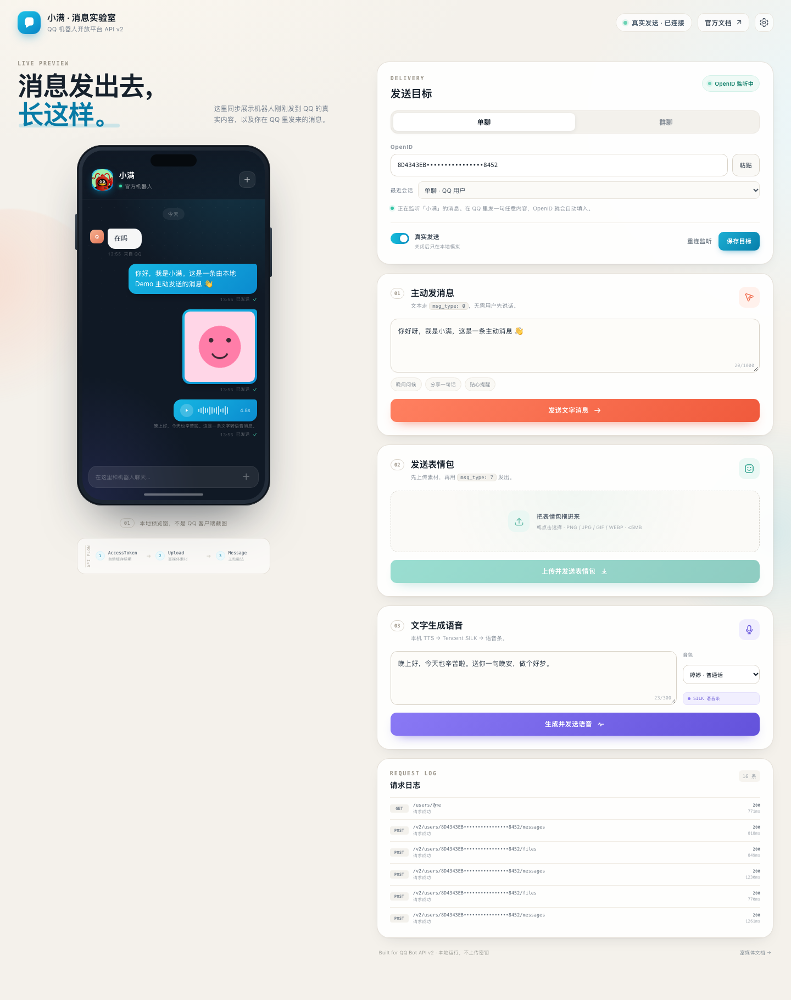

# QQ 官方机器人 API v2 · 本地 Demo

一个不依赖前端框架的本地小 Demo，用来验证 QQ 机器人开放平台 v2 的三件事：

1. **主动发消息**：页面上输入文字，点击发送，机器人主动发到 QQ（`msg_type: 0`）。
2. **发送表情包**：上传 PNG / JPG / GIF / WEBP，先传素材再发富媒体消息（`msg_type: 7`）。
3. **文字转语音**：输入文字 → macOS `say` 合成 WAV → `pysilk` 编码成 Tencent SILK v3 → 上传并发送语音条（`file_type: 3`）。

另外内置了一个 WebSocket 监听：在 QQ 里给机器人发一条消息，页面会自动捕获对方的 `openid`，不需要手动查日志。

> 官方文档：<https://bot.q.qq.com/wiki/develop/api-v2/>



## 运行

要求：macOS（语音合成依赖系统 `say`）、Python 3.10+。

```bash
cd qqbot-api-demo
cp .env.example .env        # 填入 AppID / AppSecret
./start.sh
```

打开 <http://127.0.0.1:5178>。

首次启动会自动创建 `.venv` 并安装依赖。也可以手动执行：

```bash
python3 -m venv .venv
./.venv/bin/pip install -r requirements.txt
./.venv/bin/python app.py
```

## 第一次真实发送

1. 在[ QQ 开放平台 ](https://q.qq.com/)把机器人加为好友（或拉进群）。
2. 确保 `.env` 里填了 `QQ_APP_ID` / `QQ_APP_SECRET`，启动 Demo。
3. 用你的 QQ 给机器人发任意一句话；
   - 单聊：发「你好」即可。
   - 群聊：在群里 @机器人 发消息。
4. 页面上的 **OpenID** 会自动填上，右上角会显示「真实发送 · 已连接」。
5. 回到页面，点「发送文字消息」/「上传并发送表情包」/「生成并发送语音」。

如果页面没有自动填 OpenID：

- 点「重连监听」；
- 或打开「设置 → 自动捕获 OpenID」并保存；
- 或从你自己已有机器人服务的事件日志里复制 `author.user_openid`（单聊）/ `group_openid`（群聊）填入。

## 配置项

配置优先级：`data/config.json` > `.env` > 默认值。页面上保存的设置会写进 `data/config.json`（权限 600，已被 git 忽略）。

| 变量 | 说明 |
| --- | --- |
| `QQ_APP_ID` | 开放平台 AppID |
| `QQ_APP_SECRET` | 开放平台 AppSecret |
| `QQ_TARGET_TYPE` | `c2c` 单聊 / `group` 群聊 |
| `QQ_TARGET_ID` | 对方的 `user_openid` 或 `group_openid` |
| `QQ_LIVE` | `1` 真实发送，`0` 只在页面模拟 |
| `QQ_AUTO_CAPTURE` | `1` 启动 WebSocket 自动捕获 OpenID |
| `QQ_TTS_VOICE` | 默认音色：`Tingting` / `Meijia` / `Sinji` / `Flo` |

## 接口实现

| 功能 | 官方接口 |
| --- | --- |
| 获取凭证 | `POST /app/getAppAccessToken`，缓存并在过期前刷新 |
| 机器人资料 | `GET /users/@me` |
| 单聊文本 | `POST /v2/users/{openid}/messages`，`{"content","msg_type":0}` |
| 群聊文本 | `POST /v2/groups/{group_openid}/messages` |
| 单聊上传 | `POST /v2/users/{openid}/files`，二进制 `file_data`（base64） |
| 群聊上传 | `POST /v2/groups/{group_openid}/files` |
| 富媒体发送 | `POST .../messages`，`{"msg_type":7,"media":{"file_info":...}}` |
| WebSocket | `GET /gateway/bot` → `wss://...`，intent `GROUP_AND_C2C_EVENT (1<<25)` |

请求日志会显示在页面底部，可看到 HTTP 状态、业务错误码、耗时；`file_data`、AppSecret、AccessToken 都被隐藏。

## 常见错误

| 现象 | 原因 |
| --- | --- |
| `40034105` / 「无权限」 | 主动消息权限未开通，或用户在机器人资料卡里关闭了「允许主动发送」 |
| `40034100` | 主动消息触发频控，等一会儿再试 |
| `40054004` | 还不是好友关系，先在 QQ 里添加机器人 |
| `40054013` | 用户拒收了主动消息 |
| `304080` / `40034004` | 素材 `file_info` 失效或转存失败，重新上传 |
| 上传 5MB 限制 | 官方二进制直传上限 5MB；更大的文件需要走分片上传，本 Demo 未实现 |
| WebSocket 连不上 | 机器人未开通 `GROUP_AND_C2C_EVENT` 事件权限，或 AppID/Secret 不正确 |

## 边界与说明

- 官方接口没有「发送表情包」的独立类型：图片统一按富媒体图片上传，QQ 会以图片/表情包形式展示；动画 GIF 也走同一条路径。
- 语音优先上传 SILK（`pysilk` 编码，腾讯 SILK v3）。如果机器上没有安装 `pysilk`，会回退上传 WAV，能否直接展示成语音条取决于当前账号/场景的格式支持。
- 主动消息受用户开关、认证类型、每日上限、单关系频控等限制，Demo 不绕过这些规则。
- 这是本机演示服务：监听 `127.0.0.1`，没有登录鉴权，不要直接暴露到公网。
- `data/` 下是本地运行产物（密钥、上传图片、合成语音），不要提交。

## 目录

```
qqbot-api-demo/
├── app.py              Flask 路由 + 发送编排
├── qqbot.py            Token 缓存、HTTP API 封装、配置与日志
├── gateway.py          WebSocket 监听，自动捕获 OpenID
├── tts.py              macOS say + SILK 编码
├── static/
│   ├── index.html
│   ├── styles.css
│   └── app.js
├── data/               运行时配置与媒体（忽略提交）
├── .env.example
├── requirements.txt
└── start.sh
```
